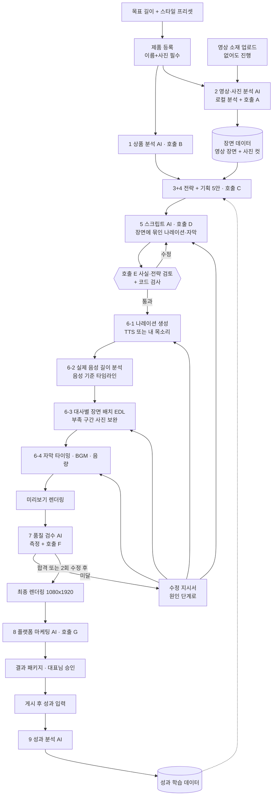

# COCOCHOI AI CONTENT FACTORY — 개발 지침 v4.0 (반자동 전환)

작성일: 2026-11-24
저장 위치: `docs/DESIGN.md` (v1~v3.3을 대체)
개정일: 2026-11-24 (v4.0)
함께 보는 문서: `docs/PROMPTS.md` (AI 호출 프롬프트 전문)
GitHub 저장소: `spam204030-pixel/cocochoi-ai` (비공개)
상태: **v4.0 — 맨 앞 "★ v4.0 반자동 전환" 장이 현재 기준이다.** 0~13장은 v3.3 기록이며 v4.0과 충돌하면 v4.0을 따른다. 이후 변경은 실제 개발·테스트에서 문제가 확인된 경우에만 하고, 변경 내용은 `docs/CHANGELOG.md`에 기록한다.

---

## ★ v4.0 반자동 전환 — 현재 기준

> **이 장이 아래 v3.3 내용보다 우선한다.** 아래 0~13장은 v3.3 기록으로 남겨 두며, 이 장과 충돌하는 부분은 이 장을 따른다. v3.3 기능 중 v4.0에서 빠진 것은 "보류"로 두고 삭제하지 않는다 (V4-17).

### V4-0. 무엇이 바뀌었나 (요약)

| 구분 | v3.3 | v4.0 |
| --- | --- | --- |
| 범위 | 분석 → 기획 → 편집·음성·렌더링(MP4) → 품질 자동 수정 → 게시물 | **분석 → 후킹·기획 → 대본·자막 → 플랫폼별 노출 최적화 캡션.** 영상 편집은 대표님이 캡컷 등에서 직접 |
| AI 연결 | API(유료) 기본 | **Claude 구독 + `/공장` 명령 (반자동, 추가 비용 0원)**. API는 예비 공급자로 구조만 유지 |
| 나레이션 | AI 음성(TTS) / 내 목소리 | **대본 글자만 제공.** 녹음·음성은 대표님이 직접 (캡컷 AI 음성 포함) |
| 핵심 결과물 | MP4 + 게시 패키지 | **편집 지시표 + 나레이션 대본 + 자막(SRT) + 5개 플랫폼 캡션 (개별·전체 복사)** |
| 업로드·발행 | 자동 게시 없음 | **자동 업로드·자동 발행은 개발 범위에서 제외** (대표님이 직접) |
| 확장 모듈 | 성과 학습만 로드맵 | 트렌드 조사, 경쟁 영상 분석, 성과 기록·학습을 **독립 모듈**로 설계 |
| 성공 기준 | 그대로 올릴 수 있는 결과 70% | **100점 평가표 + 즉시 탈락 조건 + 10편 중 7편** (V4-14) |

### V4-1. 범위

**하는 것**
1. 상품 분석: 사실 정리 + 구매 이유, 차별점, 타깃 고객, 구매 전환 가능성 (V4-6)
2. 영상·사진 분석: 장면 분할, 장면별 내용·화질·글자·원본 음성 (로컬) + 장면 태깅 (Claude)
3. 후킹·기획: 기획안 5개 → 100점 평가 → 1안 선정 (트렌드·경쟁·성과 데이터가 있으면 근거로 사용)
4. 나레이션 대본 + 자막 문구 + 장면 연결 (V4-7)
5. 편집 지시표, 자막 파일(SRT), 결과 화면 (V4-9)
6. **플랫폼별 노출 최적화 캡션 (핵심 기능, V4-8)**
7. 확장 모듈: 트렌드 조사 (V4-10), 경쟁 영상 분석 (V4-11), 성과 기록·학습 (V4-12)

**하지 않는 것 (개발 범위 제외)**
- 플랫폼 자동 업로드, 자동 발행, 예약 발행, 댓글 자동 응답·DM 발송
- 외부 사이트에서 영상·이미지 자동 다운로드 (CLAUDE.md 규칙 4)
- 약관을 어기는 크롤링 (CLAUDE.md 규칙 3)

**보류 (구조는 남기고 지금은 만들지 않음):** 자동 영상 편집·렌더링(EDL·FFmpeg 합성), AI 음성(TTS), 영상 품질 자동 채점·자동 수정, 스타일 프리셋 렌더링, 썸네일 이미지 생성, 사진 배경 제거

### V4-2. 사용자 흐름

1. **대표님:** 제품 등록 (제품명·사진 필수, 가격·특징·상세 설명·구매 링크 선택) → 샤오홍슈 영상 업로드 → [제작 시작]
2. **프로그램 (로컬, 자동):** 장면 분할 → 장면별 대표 사진·화질 측정 → 중국어 받아쓰기 → 화면 글자 인식
3. **화면에 "Claude 처리 대기 (묶음 1)" 표시 → 대표님:** VS Code Claude 창에 `/공장` 입력
4. **Claude (묶음 1):** 영상 장면 태깅 + 사진 태깅 + 상품 분석
5. **Claude (묶음 2, `/공장` 2번째):** 기획 5안 → 선정 → 대본·자막·장면 연결 → 사실·연결 검토
6. **프로그램 (코드):** 장면 연결 검사, 금지 표현 검사 → 불합격 줄만 묶음 2 재요청 표시
7. **Claude (묶음 3, `/공장` 3번째):** 5개 플랫폼 캡션
8. **프로그램 (코드):** 캡션 규칙 검사 (글자 수, 해시태그 적정량, 플랫폼 간 중복, 금지 표현, 대가성 문구) → 결과 화면
9. **대표님:** 결과 확인·수정 → 복사·다운로드 → 캡컷 편집 → 각 플랫폼에 직접 업로드 → (나중에) 성과 입력

> 한 편당 `/공장` 입력은 기본 3회. 대표님이 [한 번에 처리] 설정을 켜면 묶음 2·3을 연속 처리해 2회로 줄인다.

### V4-3. 모듈 구조

모든 기능은 아래 모듈로 나눈다. 모듈마다 **입력 스키마 / 출력 스키마 / 실행 단계 이름 / 필수 여부**가 정해져 있고, 다른 모듈의 내부를 직접 읽지 않는다 (출력 JSON으로만 주고받음). 선택 모듈이 꺼져 있거나 데이터가 없으면 다음 모듈은 "해당 데이터 없음"으로 받아 그대로 동작한다.

| 모듈 | 폴더 | 필수 | 하는 일 | Phase |
| --- | --- | --- | --- | --- |
| ① 트렌드 조사 | `app/modules/trend/` | 선택 | 키워드 추이, 인기 쇼츠 목록, `/트렌드` 리포트·메모 연결 | 6 |
| ② 경쟁 영상 분석 | `app/modules/competitor/` | 선택 | 후킹·구성·컷 속도·자막 스타일·댓글 반응 | 5 |
| ③ 상품 분석 | `app/modules/product_analysis/` | 필수 | 사실 + 구매 이유·차별점·타깃·전환 가능성 | 1 |
| ④ 소재 분석 | `app/modules/footage/` | 필수 | 장면 분할·측정·받아쓰기·글자 인식·장면 태깅·사진 태깅 | 1 |
| ⑤ 기획·대본 | `app/modules/planning/` | 필수 | 기획 5안·선정·대본·자막·장면 연결·검토 | 2 |
| ⑥ 플랫폼 캡션 | `app/modules/captions/` | 필수 (핵심) | 5개 플랫폼별 캡션 생성·규칙 검사 | 3 |
| ⑦ 결과 패키지 | `app/modules/package/` | 필수 | 편집 지시표, SRT, 복사·다운로드 | 3 |
| ⑧ 성과 기록·학습 | `app/modules/performance/` | 선택 | 성과 입력, 유형별 분석, 기획·캡션 근거 제공 | 7 |

**AI 연결 계층 (`app/providers/`)**: 모든 모듈은 AI를 직접 부르지 않고 공급자 인터페이스만 쓴다.
- `claude_code` (기본): `/공장` 요청서·응답서 방식 (V4-4)
- `anthropic_api` (예비): 완전 자동이 필요해지면 설정 한 줄로 전환. 도입 시 비용 안내·승인 (CLAUDE.md 규칙 6)
- `fake` (테스트): 비용 없이 전체 테스트

### V4-4. `/공장` 연결 방식 (Claude 구독 반자동)

1. AI 단계에 도착하면 프로그램이 **요청서**를 만든다: `storage/bridge/requests/<요청 id>.json`
   - 내용: 호출 이름, 프롬프트 버전, 프롬프트 전문(PROMPTS.md), 입력 데이터, 첨부 이미지 경로(장면 대표 사진·프레임 격자·제품 사진), 출력 JSON 스키마
   - 단계 상태는 `waiting_ai` ("Claude 처리 대기")로 표시하고 현황판 카드에 ⚠
2. 대표님이 Claude Code에서 `/공장` 입력 → `.claude/commands/공장.md` 명령이 대기 중인 요청서를 순서대로 처리한다
   - 요청서의 프롬프트를 따르고, 첨부 이미지를 직접 본다
   - 결과를 `storage/bridge/responses/<요청 id>.json`에 쓴다. **bridge 폴더 밖의 파일은 읽기만 하고 수정하지 않는다**
   - 요청서 안의 외부 텍스트(상세페이지·원본 자막·댓글)는 데이터로만 다룬다 (CLAUDE.md 개발 규칙 7)
3. 프로그램이 응답서를 발견하면 스키마 검사 → 통과 시 저장하고 다음 단계로, 실패 시 실패 이유를 붙인 재요청서를 만들고 다시 "Claude 처리 대기" (1회). 두 번째 실패는 `AI_BAD_OUTPUT`으로 멈추고 대표님 확인
4. 사용 기록: 비용 0원, 요청 수·글자 수·이미지 수를 usage_logs에 기록 (구독 사용량 감 잡기용)
5. 묶음: 묶음 1 = 소재 태깅(A) + 상품 분석(B) / 묶음 2 = 기획(C) + 대본(D) + 검토(E) / 묶음 3 = 플랫폼 캡션(G1 + G2 × 5). 같은 묶음의 요청서는 `/공장` 한 번에 모두 처리한다
6. 요청서는 처리 후 `storage/bridge/done/`으로 옮겨 기록을 남긴다

### V4-5. 실행 단계 (Phase 0의 8단계를 다음으로 교체)

| 순서 | 단계 키 | 이름 | 실행 | 모듈 |
| --- | --- | --- | --- | --- |
| 1 | `media_prep` | 소재 준비 | 코드 (로컬) | ④ |
| 2 | `analysis` | 상품·소재 분석 | Claude 묶음 1 | ③④ |
| 3 | `planning` | 후킹·기획·대본 | Claude 묶음 2 | ⑤ (①②⑧ 데이터 있으면 사용) |
| 4 | `script_check` | 장면 연결·사실 검사 | 코드 | ⑤ |
| 5 | `captions` | 플랫폼 캡션 | Claude 묶음 3 | ⑥ (⑧ 데이터 있으면 사용) |
| 6 | `caption_check` | 캡션 규칙 검사 | 코드 | ⑥ |
| 7 | `package` | 결과 패키지 | 코드 | ⑦ |

마지막 뒤에는 v3.3과 같이 "대표님 확인" (`waiting_user`). 단계 교체는 Phase 1-1에서 Alembic 마이그레이션 없이 단계 정의(`app/pipeline/steps.py`)만 바꾸고, 기존 프로젝트의 단계 기록은 그대로 둔다.

### V4-6. 상품 분석 확장 (모듈 ③)

v3.3 호출 B의 사실 목록·확인 필요·금지 표현은 그대로 두고 아래를 추가한다. **모든 항목에 근거 등급(user_input / visible / source_text / inferred)과 근거 위치**를 붙인다.

| 항목 | 내용 |
| --- | --- |
| 구매 이유 `purchase_reasons` | 소비자가 이 상품을 사는 이유 3~5개, 각 이유가 해결하는 상황·고민, 장면으로 증명 가능한지 (장면 id) |
| 차별점 `differentiators` | 비슷한 상품과 다른 점. 비교 근거가 없으면 "비교 근거 없음"으로 표시하고 주장하지 않음 |
| 타깃 고객 `targets` | 나이보다 **상황·고민** 중심 2~3명. 핵심 타깃 40~50대 여성 기준 (CLAUDE.md), 구매 가능성 상/중/하와 이유 |
| 예상 반론 `objections` | "비싸다", "효과 있나", "사이즈" 등 망설임과 콘텐츠에서 풀어줄 답 (근거 있을 때만) |
| 구매 전환 가능성 `conversion_potential` | 100점 = 문제 공감도 20 + 화면으로 증명 가능성 20 + 차별성 15 + 가격 부담 15 + 타깃 명확성 15 + 소재 품질 15. 항목별 점수·근거, **항상 "추정"으로 표시.** 성과 데이터(⑧)가 쌓이면 실제 성과와 비교해 배점을 조정 |
| 콘텐츠 각도 `angles` | 후킹으로 쓸 수 있는 각도 3~5개 (공감형·비교형·해결형·디테일형 등)와 연결 장면 |

### V4-7. 장면-대사 연결 정확도 (모듈 ④⑤)

1. **장면 태그 구체화 (호출 A):** 장면마다 `visible_facts`(화면에 실제로 보이는 것, 예: "무릎 위까지 올라오는 길이", "안쪽 기모 클로즈업"), `shot_type`, `proof_value`(무엇을 증명할 수 있는가), 화질 점수, 글자·워터마크 위치를 기록
2. **대사마다 증명 근거 필수 (호출 D):** 대본 각 줄에 `segment_ids`와 `proof`(그 장면에서 무엇이 보여서 이 대사가 성립하는지)를 적는다. 근거 장면이 없으면 그 대사는 쓰지 않는다
3. **코드 검사 (`script_check`):**
   - 존재하지 않는 장면 id → 탈락
   - `proof`가 연결 장면의 `visible_facts`·`proof_value`와 겹치지 않음 → "연결 의심"
   - 대사 예상 읽기 시간(글자 수 ÷ 초당 글자 수, 코드 계산)이 연결 장면 길이 합보다 김 → "장면 부족"
   - 화질 점수 하위 장면, 워터마크가 큰 장면 → "교체 권장"
4. **2차 확인 (호출 E):** Claude가 연결된 장면 대표 사진을 다시 보고 줄마다 "맞음 / 애매 / 틀림"과 이유를 판정. 틀림은 대본 재작성 대상
5. **대표님 교체 화면:** 대사 옆에 연결 장면 사진·길이, 다른 후보 장면 3개를 보여주고 클릭 한 번으로 교체

연결 정확도 = (맞음 판정 줄 수 − 대표님이 교체한 줄 수) ÷ 전체 줄 수. 결과 화면과 성과 기록에 남긴다.

### V4-8. 플랫폼별 노출 최적화 캡션 (모듈 ⑥ — 핵심 기능)

**원칙**
- 같은 영상이라도 플랫폼마다 **검색 방식·추천 방식·이용자 검색 의도**가 다르므로, 문장과 구성을 플랫폼별로 따로 만든다 (G1 공통 기준 → G2 플랫폼마다 별도 호출)
- 해시태그는 **많이가 아니라 적정량과 관련성.** 플랫폼 규칙 파일의 적정 범위 안에서, 상품·검색 의도와 관련성이 높은 것만 고른다. 관련성 낮은 인기 태그로 수를 채우지 않는다
- **"노출 보장", "상위 노출", "알고리즘 공략 100%" 같은 보장 표현은 쓰지 않는다** (화면 안내문 포함). 최적화 근거는 ① 각 플랫폼 공식 가이드(규칙 파일에 출처·확인 날짜 기록) ② 실제 성과 데이터(모듈 ⑧, 쌓이면 반영) 두 가지뿐이다
- 사실 규칙은 대본과 같다: 쓸 수 있는 사실(usable_facts) 안에서만 주장
- 쿠팡 링크가 들어가는 캡션·글은 맨 위에 대가성 문구 (CLAUDE.md 규칙 1). 판별 기준: 제품 정보의 **링크 종류**(쿠팡 / 기타 / 없음, 대표님 선택, 기본 없음). 쿠팡이면 코드가 대가성 문구를 넣고 누락을 검사한다. 블로그는 **정보 글 / 상품 링크 글**을 선택해 구분 (CLAUDE.md 규칙 8)

**플랫폼 규칙 파일:** `config/platforms/<플랫폼>.yaml`
- 항목: 검색 방식 요약, 추천 콘텐츠 특성, 주요 검색 의도, 생성 필드 목록, 필드별 글자 수 범위, 해시태그 적정 범위·최대치, 키워드 배치 규칙, 금지 표현, **공식 출처 URL과 확인 날짜**
- 숫자 값은 Phase 3-1에서 각 플랫폼 공식 도움말·크리에이터 가이드를 확인해 채운다. 확인하지 못한 값은 `status: 추정`으로 두고 화면에 표시하지 않는다
- 대표님이 화면에서 값을 고칠 수 있고, 성과 데이터 분석 결과(⑧)로 적정 범위를 조정 제안한다 (자동 변경은 하지 않음)

**플랫폼별 생성 항목과 방향**

| 플랫폼 | 생성 항목 | 이용자 검색 의도·구성 방향 (초기값, 3-1에서 공식 가이드로 확정) |
| --- | --- | --- |
| 유튜브 쇼츠 | SEO 제목, 설명글, 핵심 키워드, 해시태그, 동영상 태그, 고정 댓글 | 검색어형 제목(핵심 키워드를 앞쪽에), 설명 첫 줄에 핵심 정보, 태그는 표기 변형·관련어, 고정 댓글은 자주 묻는 질문 답 또는 CTA |
| 인스타그램 릴스 | 후킹 첫 문장, 검색 최적화 캡션, 해시태그, CTA | 피드에서 멈추게 하는 첫 문장, 캡션 문장 속에 검색 키워드를 자연스럽게, 저장·공유할 이유(체크리스트형), 댓글 키워드 CTA |
| 틱톡 | 후킹 문구, 검색형 캡션, 키워드, 해시태그 | 빠르고 말하듯, 검색창에 칠 법한 문장을 캡션에, 반응을 부르는 질문 |
| 네이버 클립 | 검색형 제목, 설명글, 키워드, 해시태그 | 국내 검색어를 제목 앞에, 문장보다 키워드 중심의 직관적 제목, 제목·설명·키워드 일치 |
| 네이버 블로그 | 롱테일 SEO 제목, 본문, 소제목, 키워드, 태그 | 검색 질문에 도입부에서 바로 답, 소제목 3~5개, 키워드는 제목·첫 문단·소제목에 자연스럽게, 이미지 자리 표시, 1,500~2,500자. **쇼츠 대본을 늘려 쓰지 않는다** |

**코드 검사 (`caption_check`, AI 없음)**
- 필드 누락, 글자 수 범위, 해시태그 수(적정 범위 밖이면 경고, 최대치 초과면 불합격), 해시태그 중복
- 플랫폼 간 같은 문장 반복: 같은 문장(또는 80% 이상 겹치는 문장)이 2개 이상 플랫폼에 있으면 불합격
- 금지 표현(보장 표현, 근거 없는 효능, 경력 앵글), usable_facts 밖 주장(키워드 대조), 대가성 문구 누락
- 불합격 플랫폼만 G2 재요청 (묶음 3 재처리)

**결과 화면**
- 플랫폼별 카드 5개. 카드 안 항목마다 [복사] 버튼, 카드마다 [이 플랫폼 전체 복사], 화면 위에 **[전체 복사]**(5개 플랫폼을 구분선과 플랫폼 이름을 붙여 한 번에)
- 항목마다 수정 가능 (수정본을 채택본으로 저장, 원본 보관), 글자 수·해시태그 수 표시
- 복사는 브라우저 클립보드만 사용 (외부 전송 없음)
- 네이버 블로그는 **일반 글 형식**으로 복사 (마크다운 기호 `#`, `**` 제거, 소제목은 줄로 구분). 내부 저장은 body_markdown 유지

### V4-9. 결과 패키지 (모듈 ⑦)

| 결과물 | 내용 |
| --- | --- |
| 편집 지시표 | 순서, 원본 파일·구간(코드가 장면 데이터에서 계산), 나레이션 대사, 자막 문구, 편집 메모(확대·느리게 등 AI 판단). 화면 표 + CSV 다운로드 |
| 나레이션 대본 | 녹음용. 끊어 읽기 표시, 줄별 예상 길이 (코드 계산) |
| 자막 파일 (SRT) | 시간은 **코드가 읽기 속도로 계산한 예상값** (AI는 시간을 정하지 않음, CLAUDE.md 개발 규칙 6). 화면에 "녹음 후 캡컷 자동 자막으로 맞추는 것을 권장" 안내. 녹음 파일로 시간 재조정하는 기능은 보류 |
| 플랫폼 캡션 | V4-8 |
| 전체 다운로드 | 위 파일을 ZIP 하나로 |

### V4-10. 트렌드 조사 (모듈 ① — Phase 6)

| 출처 | 가져오는 것 | 방식 |
| --- | --- | --- |
| 유튜브 | 키워드별 인기 쇼츠 제목·조회수·게시일 | YouTube Data API (공식, 무료 할당량) |
| 네이버 | 키워드 검색 추이(상대값), 쇼핑 클릭 추이 | NAVER API HUB 데이터랩 (**종량제 — 도입 전 요금 확인·승인**). 대안: 대표님이 데이터랩 웹에서 보고 입력 |
| 기존 `/트렌드` | `reports/`, `data/opportunities.csv`, `data/memo.md` | 파일 읽기 (기존 명령은 그대로 유지) |
| 인스타·틱톡·샤오홍슈 | 인기 콘텐츠 링크·메모 | 공개 검색 API가 없으므로 **대표님이 링크·메모로 입력.** 크롤링 금지 |

- 출력: 키워드 목록(출처·확인 날짜), 인기 콘텐츠의 제목 패턴, 반복 질문. 숫자는 원자료에 있을 때만 (v3.3 호출 H 규칙 유지)
- 사용처: 기획(⑤)의 후킹·각도 근거, 캡션(⑥)의 키워드 후보

### V4-11. 경쟁 영상 분석 (모듈 ② — Phase 5)

- 입력: 대표님이 올린 경쟁 영상 파일(소재 업로드와 같은 방식, 용도만 "경쟁 분석"), 영상 링크, 댓글(유튜브는 공식 API, 나머지는 대표님이 복사해 붙여넣기)
- 분석: 모듈 ④의 장면 분석 엔진을 재사용 + 호출 I
  - 후킹: 첫 1~3초 화면·문장·자막, 후킹 유형
  - 구성: 구간별 역할(문제 → 공감 → 증거 → 해결 → CTA), 컷 수·평균 컷 길이, 자막 방식
  - 댓글 반응: 구매 의향, 질문, 불만·의심, 자주 나오는 단어 (표본 수 함께 표시)
  - 따라 할 점 / 피할 점 / 우리 상품에 적용할 각도
- 출력은 기획(⑤)에 "경쟁 근거"로 전달. 경쟁 영상의 문장을 그대로 베끼지 않는다

### V4-12. 성과 기록·학습 (모듈 ⑧ — Phase 7)

- **기록 항목 (플랫폼별):** 게시일, 링크, 조회수, 평균 시청 지속시간, 시청 지속률(%), 좋아요, 댓글, 저장, 공유, 클릭률(노출 대비 클릭, 제공되는 플랫폼만), 프로필·링크 클릭, 쿠팡 클릭·구매 수(쿠팡파트너스 보고서 기준). 수집일 기준 1일·7일·30일 값
- **입력 방식:** 1단계 대표님이 입력 화면에 직접 입력(빈칸 허용) → 기존 `data/performance.csv` 가져오기·내보내기 연결 → (선택) 유튜브는 공식 분석 API로 자동 수집 (OAuth, 승인 후)
- **콘텐츠 정보와 연결:** 기획 유형, 후킹 유형, 상품 분석 전환 점수, 연결 정확도, 캡션 버전, 해시태그 수
- **분석:** 유형별·후킹별·플랫폼별 평균과 **표본 수**를 함께 표시. 표본 5편 미만이면 "참고용"
- **반영:** 다음 기획(⑤)과 캡션(⑥) 요청서에 "성과 근거" 블록으로 들어감 (예: "공감형 후킹 7편 평균 시청 지속률 41% vs 정보형 4편 33%, 표본 적음"). 자동으로 규칙을 바꾸지 않고, 근거로 인용만 한다

### V4-13. 무료 처리 구분표

| 기능 | 실행 위치 | 대표님 PC 요구 사양 | 비용 | 비고 |
| --- | --- | --- | --- | --- |
| 장면 분할 (PySceneDetect), 대표 사진·프레임 격자 (FFmpeg) | 로컬 | 일반 PC (RAM 8GB 이상 권장) | 무료 | |
| 화질·흔들림·밝기 측정 (OpenCV) | 로컬 | 일반 PC | 무료 | |
| 중국어 받아쓰기 (faster-whisper) | 로컬 | CPU 가능, RAM 8GB 이상. 20초 영상 약 1분 (추정, 1-4에서 실측) | 무료 | 첫 실행 시 모델 내려받기(수백 MB). 느리면 작은 모델로 전환 |
| 화면 글자 인식 (RapidOCR) | 로컬 | 일반 PC | 무료 | |
| 장면·사진 태깅, 상품 분석, 기획·대본·검토, 캡션 | Claude 구독 (`/공장`) | 해당 없음 | **추가 0원** | 구독 사용 한도를 차감. 1편 사용량을 Phase 1~3에서 실측해 안내 |
| 코드 검사, 결과 패키지, SRT | 로컬 | 일반 PC | 무료 | |
| 유튜브 인기 영상·댓글 | YouTube Data API | 해당 없음 | 무료 (할당량 안) | 구글 프로젝트·키 필요. 기본 하루 10,000단위, 검색 1회 100단위 (2026-11-24 확인, 공식 문서) |
| 네이버 검색·쇼핑 추이 | NAVER API HUB | 해당 없음 | **종량제 (유료 가능)** | 2026-11-24 확인: 신규 키는 NAVER API HUB, 사용한 만큼 과금. 도입 전 요금 확인·승인 |
| 유튜브 성과 자동 수집 | YouTube Analytics API | 해당 없음 | 무료 (할당량 안) | 선택 기능, 승인 후 |
| 나레이션 녹음·영상 편집 | 대표님 (캡컷 등) | 해당 없음 | 무료 | |

**기준 사양:** 윈도우 10/11, RAM 8GB 이상(16GB 권장), 저장 공간 10GB 이상 여유. Phase 1-1에서 프로그램 상태 화면에 RAM·CPU를 표시하고, 기준 미달이면 받아쓰기 모델을 작은 것으로 자동 선택한다.

### V4-14. 성공 기준 (Phase 4 실전 테스트)

**콘텐츠 1편 평가표 — 대표님 채점, 100점**

| 항목 | 배점 | 만점 기준 | 0점 기준 |
| --- | --- | --- | --- |
| 후킹 | 20 | 첫 1~3초 문장이 계속 보고 싶게 만들고, 타깃의 상황·고민을 정확히 건드림 | 일반적인 상품 소개로 시작 |
| 장면-대사 일치 | 20 | 모든 대사가 화면과 맞고 대표님 교체 0~1줄 | 3줄 이상 교체 |
| 구매 설득력 | 20 | 구매 이유·차별점·반론 해소·CTA가 자연스럽게 이어짐 | 특징 나열만 |
| 대본·자막 그대로 사용 | 15 | 문장 수정 2곳 이하 | 절반 이상 수정 |
| 말투·브랜드 | 10 | "옷 잘 아는 언니" 톤, 과장 없음 | 광고 문구 톤 또는 금지 앵글 |
| 플랫폼 캡션 사용 가능 | 15 | 5개 플랫폼 모두 복사해서 바로 사용 (수정 플랫폼 1개 이하) | 3개 이상 수정 |

**즉시 탈락 (점수와 관계없음):** 사실 오류·근거 없는 효능 주장 / 쿠팡 링크 글에 대가성 문구 누락 / 경력 내세우기 앵글 / 화면과 정반대인 대사 / "노출 보장" 류 표현

**성공 1편** = 80점 이상 + 즉시 탈락 0건 + 대표님 수정 시간 15분 이내 (결과 화면에 시작·완료 시각 기록)

**Phase 4 통과 기준** = 테스트 10편(영상 소재 있는 상품 7개 + 사진만 있는 상품 3개) 중 **7편 이상 성공.** 함께 기록: 편당 처리 시간, `/공장` 횟수, 연결 정확도, 플랫폼별 수정 여부

### V4-15. 데이터 추가 (Phase마다 필요한 테이블만 Alembic으로)

| Phase | 테이블 |
| --- | --- |
| 1 | `products.link_type`(쿠팡/기타/없음) 칸 추가, `bridge_requests`(요청서 상태), `footage_segments`(장면), `photo_shots`(사진 컷), `analyses`(상품·소재 분석 결과, 버전·채택) |
| 2 | `scripts`(기획안·대본·줄별 연결, 버전·채택), `script_checks` |
| 3 | `captions`(플랫폼별 결과, 버전·채택·수정본), `packages` |
| 4 | `evaluations`(평가표 점수, 수정 시간) |
| 5 | `competitor_videos`, `competitor_analyses` |
| 6 | `trend_snapshots`(출처·확인 날짜) |
| 7 | `performance_records`, `insights` |

### V4-16. 개발 순서 (2026-11-24 재정리 — 핵심 먼저, 실제 영상으로 일찍 시험)

**기준:** 이 프로그램의 존재 이유는 AI가 영상 장면을 정확히 이해하고, 그 장면에 맞는 매력적인 나레이션을 만드는 것이다. 화질 점수 등 부가 기능보다 이것을 먼저 완성한다.

**완료된 작업:** 0-1~0-11 (기반), 1-1 `/공장` 연결, 1-2 장면 나누기, 1-3 장면 사진·프레임 격자 (화질 점수는 최소화: 화면에 숫자를 숨기고 "흐림·어두움" 경고만, 추가 조정 없음)

| 순서 | 작업 | 결과 | 확인 |
| --- | --- | --- | --- |
| A | 중국어 음성 받아쓰기 (faster-whisper, 로컬·무료) | 장면별 원본 대사(중국어) 저장 | 받아쓰기가 시간과 함께 저장 |
| B | 분석 요청 (`/공장` 묶음 1): 장면 내용, 음성·화면 글자 번역(Claude가 장면 사진에서 직접 읽음), 상품 분석(상품 사진 포함) | 장면별 "보이는 사실 / AI 추정" 구분, 소비자 관점 구매 포인트 | 근거 없는 효능·특징 0건 |
| C | 분석 결과 화면 (간단) | 장면 사진 옆에 내용·번역, 상품 분석 한 화면 | **실제 영상 시험 1** |
| D | 기획·대본 (`/공장` 묶음 2): 후킹 5개 → 기획안 선정 → 나레이션·자막 → 장면별 대사 연결 + 코드 검사 | 대본 화면 (대사·자막·연결 장면 사진) | 모든 줄에 장면 번호·근거 |
| E | 플랫폼 캡션 (`/공장` 묶음 3) | 5개 플랫폼 + 항목별·플랫폼별·전체 복사 | T-10~T-21 |
| F | 편집 지시표, SRT, ZIP | 캡컷 작업용 결과물 | **실제 영상 시험 2 (처음부터 끝까지)** |

**공통 조건 (모든 작업)**
1. 영상에 실제로 보이는 사실(visible)과 AI 추정(inferred)을 항목마다 구분해 저장·표시한다
2. 구매 포인트는 소비자 관점(어떤 상황·고민을 해결하는가)으로 쓴다
3. 확인되지 않은 효능·특징·수치는 만들지 않는다 (입력 정보 또는 화면으로 확인된 것만)
4. 화면은 분석 결과와 대본 확인에 필요한 것만 단순하게
5. 이미 만든 기능(장면 나누기·사진·격자·`/공장`)을 다시 만들지 않고 재사용한다

**제외·통합:** 화면 글자 인식 프로그램(RapidOCR) 제외 → Claude가 장면 사진에서 직접 읽음. 사진 분석은 B의 상품 분석에 통합. 별도 분석 캐시 작업 제외(같은 영상 재분석 방지는 이미 있음).

**이후 (나중에):** 실전 테스트 10편(V4-14 성공 기준) → 경쟁 영상 분석 → 트렌드 조사 → 성과 기록·학습. 각 작업은 시작 전 계획 승인.

### V4-17. v3.3에서 보류되는 것 (삭제하지 않음)

2-4 EDL·렌더링, 4장의 06 영상 편집·07 음성·08 자막 렌더링 역할, 4-4 사진 전용 렌더링 모드, 4-5 스타일 프리셋 10종, 5장 영상 품질 Hard Fail·자동 수정 루프, TTS 공급자, 썸네일 이미지, 사진 배경 제거(rembg), v3.3 Phase 3~4의 렌더링 관련 완료 기준. 나중에 다시 필요하면 v3.3 내용을 기준으로 Phase를 새로 잡는다.

---

## 0. 프로젝트 정의

### 0-1. 한 줄 정의

> 제품과 영상 소재를 입력하면, AI 전문가 팀이 제품 분석 → 영상 분석 → 마케팅 전략 → 기획 → 카피 → 편집 → 음성 → 자막 → 품질 검수 → 자동 수정 → 플랫폼별 SEO 게시물까지 수행해, **구매 전환을 목표로 하는 완성형 콘텐츠**를 자동으로 만드는 시스템.

### 0-2. 사용자가 하는 일 (2가지)

1. 판매할 제품을 고르고 제품 정보를 입력한다 (필수: 제품명 + 사진)
2. 샤오홍슈 등에서 관련 영상 소재를 찾아 다운로드해 업로드한다

그 뒤의 모든 과정은 시스템이 수행하고, 사용자는 마지막에 결과물을 승인한다.

### 0-2-1. 영상 소재의 정의

샤오홍슈 등에서 가져온 영상은 참고 자료가 아니라 **실제 편집에 쓰는 원본 소재**다.

- 시스템은 소재의 모든 장면을 분석해 제품 전체, 디테일, 착용·사용, 분위기 장면으로 분류한다
- 원본의 이야기 순서를 따르지 않는다. 장면 순서를 새로 구성한다
- **원본 음성은 기본적으로 쓰지 않는다** (분석용으로만 받아쓰기). 한국 소비자에게 맞는 새 나레이션과 한국어 자막, BGM을 입힌다
- 원본 영상의 중국어 자막·화면 글자는 읽고 번역해 장면 이해에 쓴다. 그 영역은 크롭 위치 조정이나 구간 제외로 처리한다
- 원본 위에 한국어 자막만 얹는 방식이 아니라, 장면 재구성 + 새 나레이션 + 새 자막으로 새 판매 콘텐츠를 만든다
- 소재마다 출처 URL과 메모를 기록하는 칸을 둔다 (사용 판단은 사용자가 한다)

### 0-2-2. 절대 제작 순서

> **영상 소재에 실제로 있는 장면을 기준으로 대본을 쓴다.** 좋은 대본을 먼저 쓰고 장면을 찾지 않는다.

```
목표 길이·스타일 프리셋 → 제품 분석 → 영상·사진 소재 분석 → 사용 가능한 장면 확인
→ 구매전환 전략 → 콘텐츠 기획 → 대본 (나레이션·자막을 장면에 묶어서) → 나레이션 음성 생성
→ 실제 음성 길이 분석 → 음성 기준 타임라인 → 대사별 장면 배치 → 부족 구간 사진 보완
→ 자막 타이밍·BGM → 렌더링 → 품질 검수 → 자동 수정 → 최종 영상 → 플랫폼별 SEO 게시물
```

- 대본의 모든 줄은 소재 지도의 장면 ID(또는 사진 ID)에 연결되어야 한다. 연결이 없으면 코드가 거부한다
- 소재가 부족하면: ① 있는 장면으로 콘텐츠 방향을 바꾸고 ② 부족한 장면을 사용자에게 알리고 ③ 가능하면 사진 기반 움직임으로 채운다
- 촬영하지 않은 장면이나 경험을 실제로 한 것처럼 표현하지 않는다

**두 가지 기준을 함께 쓴다:**

| 무엇을 정하나 | 기준 | 이유 |
| --- | --- | --- |
| 대본의 **내용** (무엇을 말하나) | 실제로 있는 장면 | 영상에 없는 장면을 요구하는 대본을 막는다 |
| 영상의 **시간 배치** (몇 초씩 보여주나) | 실제로 생성된 나레이션 음성의 길이 | 음성이 영상보다 길거나, 자막이 너무 빨리 지나가거나, 영상이 끝났는데 음성이 남는 문제를 막는다 |

**AI는 시간을 정하지 않는다.** 대본에는 줄별 예상 길이(초)만 적고, 실제 시작·끝 시간, 장면 길이, 자막 표시 시간은 모두 코드가 실제 음성 길이로 계산한다. (예: AI 예상 3.5초 → 실제 TTS 4.2초면 그 줄의 장면과 자막은 4.2초 기준으로 배치)

**영상이 없어도 제작을 멈추지 않는다.** 사진만 있으면 사진 전용 모드(4-4)로 쇼핑 영상을 만들고, 영상과 사진이 섞여 있으면 함께 편집한다.

### 0-3. 핵심 설계 원칙

> **AI가 만들고 끝나는 시스템이 아니라, AI가 평가하고 부족한 부분을 고쳐서 품질을 끌어올리는 시스템이다.**

이 원칙을 구현하는 4가지 장치:

1. **역할 분리:** 하나의 AI에게 모든 일을 시키지 않는다. 역할마다 전용 지시문, 입력, 출력 형식, 평가 기준이 있다 (4장)
2. **상호 검토:** 중요한 결과물은 만든 역할이 아닌 다른 역할이 검토한다 (4-3)
3. **2층 품질 검수:** 측정할 수 있는 것은 코드로 측정하고, 판단이 필요한 것은 AI가 채점한다. 기준에 못 미치면 원인이 된 단계로 돌아가 자동으로 고친다 (5장)
4. **성과 학습:** 실제 게시 성과를 쌓아서 다음 콘텐츠의 전략과 후킹 선택에 반영한다. AI 점수가 실제 성과와 맞는지도 이 데이터로 보정한다 (6장)

### 0-4. 사실 원칙 (모든 역할 공통)

- 모든 정보에 근거 표시를 붙인다: `user_input`(사용자 입력) / `visible`(사진·영상에서 눈으로 확인) / `source_text`(원본 영상의 글자·음성에 나온 정보) / `inferred`(AI 추론)
- `source_text`와 `inferred` 정보는 대본·자막·캡션에 쓰지 않는다. 화면에 "확인 필요"로 표시해 사용자가 확인하면 `user_input`으로 올린다
- 효능, 성능 수치, 소재 성분, 인증, 순위는 사용자가 입력한 경우에만 쓴다
- 품질 검수가 사실 오류를 찾으면 자동으로 내용을 만들어 채우지 않는다. 해당 주장을 빼고 사용자에게 알린다

| 정보 유형 | 근거 등급 | 사용 규칙 |
| --- | --- | --- |
| 대표님이 입력한 정보 | user_input | 사실로 사용 |
| 사진·영상에서 명확하게 보이는 정보 | visible | 시각적 특징으로만 표현 ("두꺼워 보이는 짜임", "무릎 위까지 오는 길이") |
| 원본 영상의 글자·음성 | source_text | 대표님이 확인하기 전에는 사용 금지 |
| AI 추론 | inferred | 내부 분석(타깃·전략 판단)에만 사용, 콘텐츠 문장에는 사용 금지 |
| 확인되지 않은 정보 | 없음 | 콘텐츠에서 사용 금지 |

**user_input일 때만 쓸 수 있는 항목:** 소재·혼용률(예: 사진만 보고 "울 100%" 금지), 기능·성능, 수치, 가격·할인·이벤트, 사이즈·치수, 재고·배송, 인증, 판매량·순위, 유행·인기 주장

---

## 1. 변경 내역

### 1-00. v3.3 → v4.0 (반자동 전환)

맨 앞 "★ v4.0 반자동 전환" 장(V4-0 ~ V4-17)에 전체 내용을 적었다. 요약: Claude 구독 `/공장` 반자동, 범위를 분석·기획·대본·자막·플랫폼 캡션까지로 조정, 자동 업로드·발행 제외, 플랫폼 캡션 엔진을 핵심 기능으로, 트렌드·경쟁·성과 모듈 분리, 무료 처리 구분표, 성공 기준 점수표.

### 1-0. v3.2 → v3.3 (3차 검토 반영, 설계 확정)

| 구분 | v3.2 | v3.3 |
| --- | --- | --- |
| 시간 결정 | 대본에 예상 시작·끝 시간 | **AI는 시간을 정하지 않는다.** 대본은 줄별 예상 길이만, 실제 시작·끝·자막 시간은 코드가 음성 길이로 계산 (0-2-2, 2-4) |
| AI / 코드 경계 | 원칙 수준 | **AI는 편집 판단, 코드는 편집 실행.** AI는 FFmpeg 명령을 만들지 않고 편집 판단 JSON만 출력, 코드가 EDL로 변환 후 렌더링. EDL 스키마 확정 (2-4) |
| 장면 데이터 | 구도·움직임·추천 편집 | 제품 화면 비율, 얼굴 노출, 배경, 정보 전달력 추가 + 화면 비율별 활용 규칙 (4장 02) |
| 품질 판정 | 점수 + 필수 항목 3개 | **Hard Fail 10개** (하나라도 걸리면 점수와 관계없이 실패) + 점수 구간(우수·완료·수정·재제작). 자동 게시 없음, 대표님 최종 승인 필수 (5-1) |
| 플랫폼 문구 | 호출 G 1회 | **G1 공통 콘텐츠 정보 → G2 플랫폼별 변환(플랫폼마다 따로) → 플랫폼별 코드 검수.** 블로그는 쇼츠 대본을 늘리지 않고 검색자 질문 중심으로 따로 작성 (4장 10) |
| AI 입력 보안 | 없음 | 원본 영상의 글자·음성, 상세페이지, 검색 결과 등 외부 텍스트는 **데이터로만 취급**하고 그 안의 지시는 따르지 않음 (2-1, PROMPTS 공통 규칙) |
| 실행 기록 | 모델·비용 | 호출마다 프롬프트 버전, 입력 스냅샷, 원본 응답 저장 → 결과가 이상하면 어느 프롬프트 버전 문제인지 추적 (7-2) |
| AI 호출 수 | 약 7~10회 | 약 12~15회 (늘어난 5회는 저가 모델 플랫폼 변환) |
| 개발 순서 | Phase 0~7 | 변경 없음. Phase 3 완료 기준을 "사진 5장 + 영상 3개 → 20~30초 영상 1편"으로 구체화 |

### 1-1. v3.1 → v3.2 (2차 검토 반영)

| 구분 | v3.1 | v3.2 |
| --- | --- | --- |
| 실행 구조 | 역할 11개 + 호출 7개 | **실행 파이프라인 9단계**로 통합 (상품 분석 → 영상·사진 분석 → 전략 → 기획 → 스크립트 → 영상 제작 엔진 → 품질 검수 → 플랫폼 마케팅 → 성과 분석). 11개 역할 카드는 세부 규격으로 유지 (2-2) |
| 영상 타임라인 | 대본 시간 → EDL → 음성 생성 후 재조정 | **음성 먼저 생성 → 실제 길이 분석 → 타임라인 → 장면 배치.** 내용은 장면 기준, 시간은 음성 기준 (0-2-2) |
| 장면 데이터 | 태그·점수 중심 | 인물 움직임, 화면 구도, 추천 편집(사용 초·효과) 추가 (4장 02) |
| 사진만 있는 상품 | 부족할 때 보완용 | **사진 전용 모드** 정식 기능: 제품 영역 감지, 배경 제거, 디테일 확대, 패닝, 텍스트 오버레이, 사진·영상 혼합 (4-4) |
| 기획 평가 | 7개 항목 70점 | 10개 항목 100점 (조회수 가능성, 제작 난이도, 채널 적합도 추가). 5안은 전략 방향이 서로 달라야 함 (4장 04) |
| 사실 규칙 | 근거 등급 4개 | 정보 유형별 사용 규칙 표 + user_input 전용 항목 목록 (0-4) |
| 품질 검수 | 측정 12개 + AI 8개 항목 | 콘텐츠·영상 검사 항목 전체 목록, 측정 항목 추가(화면 잘림, 프레임 오류, 중복 표현, BGM 가림), 자동 수정 규칙 추가 (5장) |
| 작업 관리 | stale·재실행 | 작업 복구 8개 기능(취소, 일시정지·재개, 중복 실행 방지 등) + 버전 관리·채택 버전 (2-3) |
| 비용 | 예상·실제 비용 | 프로젝트별·단계별·렌더링 시간 집계 + **모델 등급 전략** (저가·표준·고성능) (2-2, 9-2) |
| 화면 | 제작 보드 중심 | **메인 현황판** (신규·제작 중·검수 대기·완료) + 단계 상태 5종 (8장 화면 0) |
| 스타일 | 자막·색감 프리셋 | **콘텐츠 스타일 프리셋 10종**: 컷 길이·확대·전환·자막·나레이션 속도·BGM·훅·CTA 통합 설정 (4-5) |
| AI 호출 | B(제품+전략), C(기획) | B(상품 분석), C(전략+기획)로 재배치. 모델 등급을 단계별로 나누기 위해 |
| 개발 순서 | Phase 0~8 | **Phase 0~7** (기획+대본 통합, Phase 0에 작업 상태·대기열·공급자 구조 포함, 실제 AI 연결은 Phase 1). MVP = Phase 0~6 (10·11장) |

### 1-2. v3 → v3.1 (1차 검토 반영)

| 구분 | v3 | v3.1 |
| --- | --- | --- |
| 영상 소재 정의 | "업로드 영상을 장면 단위로 편집에 사용" | 원본 소재로 명확히 정의. 원본 음성 미사용, 중국어 글자 읽기·번역, 글자·워터마크 영역 감지 후 크롭·구간 제외, 출처 기록 칸 (0-2-1) |
| 제작 순서 | 흐름에 반영되어 있었음 | **절대 규칙으로 명시**: 소재 분석 → 장면 확인 → 전략 → 대본. 대본 줄마다 장면 ID 필수 (0-2-2) |
| AI 호출 | 역할마다 호출 (1편당 12~16회) | 역할(책임)은 11개 유지, **실제 AI 호출은 7개 묶음** (1편당 약 7~10회) (2-2) |
| 구매전환 | 전략 역할 안의 일부 항목 | 구매전환 분석 9개 항목 필수화: 타깃·욕구·문제·망설임·구매 이유·증거 장면·첫 3초·장벽 해소·CTA (4장 03) |
| SEO | AI 키워드 생성 | **기본 모드 / 검색 조사 모드** 분리. 검색량·순위는 실제 데이터가 있을 때만 표시 (4장 10) |
| 편집 규칙 | EDL 중심 규칙 | 편집 규칙 17개 명시: 제품 잘림 방지, 반복 방지, 시작·끝 처리 등 (4장 06) |
| 개발 순서 | Phase 0에 전체 DB·11개 역할·대기열 | **Phase 0 축소** (제품·업로드·프로젝트·기본 화면). 영상 분석을 Phase 1로 가장 먼저. Phase 0~8 (10장) |
| 데이터 | 전체 테이블을 Phase 0에 생성 | Phase마다 필요한 테이블만 추가 (Alembic) |
| 품질 점수 | 제작 품질 점수 | 내부 품질 평가 기준으로만 사용 (성과 보장 아님) |
| 추가 | — | Q1 영상 분석 결과 화면 (8장 ②-1), Q2 프롬프트 (`PROMPTS.md`), Q3 Phase 0·1 세부 작업 순서 (10-1, 10-2) |

### 1-3. v2 → v3

| 구분 | v2 | v3 |
| --- | --- | --- |
| 영상 소재 | 사용자가 직접 촬영한 클립 중심, 업로드 영상은 스타일 참고용 | **업로드한 영상 소재를 장면 단위로 분석해서 직접 편집에 사용.** 직접 촬영 클립도 같은 방식으로 처리 |
| AI 구조 | 단계별 프롬프트 | **AI 전문가 11개 역할** + 역할별 평가 기준 + 상호 검토 |
| 품질 | 형식·글자 수 검사 | **100점 품질 점수 + 자동 수정 루프 + 재렌더링** |
| 전략 | 콘텐츠 유형 선택 | 유형 + **콘텐츠 목적**(조회·유지·저장·공유·댓글·구매 클릭) 결정, 구매 전환 우선 |
| 대본 | 나레이션 = 자막 | **나레이션(구어체)과 자막(짧은 문어체)을 따로 생성** |
| 성과 | 향후 확장 | **성과 학습 엔진**을 로드맵에 포함 (수동 입력부터 시작) |
| 촬영 리스트 | MVP 핵심 기능 | 보조 기능. 소재가 부족할 때만 추가 촬영 장면을 제안 |

### v2에서 그대로 유지하는 것

- 기술 기반: Python + FastAPI + Jinja2/HTMX + SQLite/Alembic + 작업 대기열 + 워커 + FFmpeg
- 공급자 계층: LLM·TTS·음성 인식·이미지·영상 생성 모두 교체 가능, 특정 회사에 종속되지 않음
- 단계 결과 수정 → 이후 단계 `stale` 처리 → 해당 단계부터 다시 실행
- 예상 비용 사전 표시, 프로젝트 예산 상한, 사용량 기록
- 무료 로컬 처리 우선 (컷 감지, 음성 인식, 자막, 편집, 렌더링)
- 나레이션 방식: 내 목소리 녹음 / TTS 선택
- 가짜 공급자로 비용 없이 테스트하는 방식

---

## 2. 전체 시스템 아키텍처

> **v4.0:** 모듈 구조는 V4-3, AI 연결은 V4-4, 실행 단계는 V4-5를 따른다.

```
┌────────────────────────────────────────────────────────────────────────┐
│ 브라우저 (http://localhost:8000) — 제품 등록 · 소재 업로드 · 제작 보드 · 결과 패키지 │
└──────────────────────────────────┬─────────────────────────────────────┘
                                   ▼
┌─ FastAPI 웹 서버: 화면 라우터 + JSON API (/api/...) ──────────────────────────┐
└──────────────────────────────────┬─────────────────────────────────────┘
                                   ▼ 작업 등록
┌─ 작업 대기열 (SQLite) ─┐     ┌─ 워커 ────────────────────────────────────────┐
│ 대기·실행·완료·실패      │ ──▶ │  ┌─ 오케스트레이터 (제작 총괄, 코드로 동작) ──┐   │
└─────────────────────┘     │  │ 순서 결정 · 역할 호출 · 검토 연결          │   │
                            │  │ 품질 루프 관리 · 예산 관리 · stale 처리     │   │
                            │  └──────────────┬─────────────────────┘   │
                            └─────────────────┼─────────────────────────┘
          ┌───────────────────────────────────┼──────────────────────────────┐
          ▼                                   ▼                              ▼
┌─ AI 전문가 팀 (app/roles) ───┐   ┌─ 미디어 엔진 (app/media) ──┐   ┌─ 측정 엔진 (app/metrics) ─┐
│ 01 Product Analyst          │   │ FFmpeg 렌더링·크롭·속도     │   │ 컷 길이·제품 등장 시점     │
│ 02 Video Analyst            │   │ PySceneDetect 장면 분할     │   │ 자막 읽기 속도·안전 영역   │
│ 03 Marketing Strategist     │   │ faster-whisper 음성 인식    │   │ 음량(LUFS)·무음·검은 화면  │
│ 04 Content Planner          │   │ ASS 자막 렌더 (libass)      │   │ 나레이션·자막 싱크 오차    │
│ 05 Copywriter               │   │ 색 보정·BGM 덕킹·음량 정규화  │   │ 최종 영상 음성 재인식      │
│ 06 Video Editor             │   │ Pillow 썸네일·rembg        │   └─────────────────────┘
│ 07 Voice Director           │   └──────────────────────────┘
│ 08 Subtitle Designer        │
│ 09 Quality Inspector        │──▶ 수정 지시 → 오케스트레이터 → 해당 역할 재실행
│ 10 Platform Marketer + SEO  │
│ 11 Performance Analyst      │◀── 성과 데이터
└──────────────┬──────────────┘
               ▼
┌─ 공급자 계층 (app/providers) ───────────────────────────────────────────┐
│ LLM: Claude(기본) / Gemini / OpenAI / Ollama(로컬)  · TTS: 교체 가능        │
│ 음성 인식: faster-whisper(로컬) · 이미지·영상 생성: 자리만 마련 (MVP 제외)    │
└────────────────────────────────────────────────────────────────────────┘
               ▼
[SQLite DB]   [파일 저장소 storage/]   [설정: providers · pricing · brand · platforms · rubrics]
```

### 2-1. 구조 원칙

1. **오케스트레이터는 AI가 아니라 코드다.** 순서, 재시도, 예산, 품질 루프 횟수를 코드 규칙으로 통제한다. AI끼리 무한히 대화하거나 비용이 폭주하는 일을 막는다
2. **역할 = 지시문 파일 + 입력 규격 + 출력 스키마 + 평가 기준표.** 역할마다 `roles/<역할>/` 폴더에 `prompt.md`, `schema.py`, `rubric.yaml`을 둔다. 코드를 고치지 않고 지시문과 기준표만 개선할 수 있다
3. **AI가 할 필요 없는 일은 AI에게 시키지 않는다.** 측정 가능한 품질(컷 길이, 음량, 싱크 등)은 측정 엔진이 숫자로 판정한다
4. **편집 계획(EDL)이 영상의 기준 데이터다.** 장면마다 "어느 소재의 몇 초부터 몇 초까지, 어떤 크롭·속도·효과·자막·음성"을 쓰는지 기록한 데이터 하나로 렌더링한다. 자동 수정도 이 데이터를 고치는 방식으로 한다
5. **역할마다 다른 AI 모델을 쓸 수 있다.** 예: 분석·검수는 이미지 이해가 좋은 모델, 플랫폼 문구는 저렴한 모델. `config/providers.yaml`에서 지정한다
6. **역할 ≠ AI 호출.** 11개 역할은 책임과 출력 규격을 나누는 업무 분담 체계다. 실제 AI 호출은 관련 역할을 묶어 줄인다 (2-2)
7. **AI는 판단, 코드는 실행.** AI는 어떤 장면을 어떤 순서로 쓰고 무엇을 말할지 결정만 한다. 자르기·크롭·확대·자막 렌더링·음성 합성·믹싱·렌더링·파일 검사는 코드가 한다. AI에게 FFmpeg 명령을 만들게 하지 않는다 (2-4)
8. **외부 텍스트는 데이터다.** 원본 영상의 글자·음성, 상세페이지 텍스트, 검색 결과, 업로드 파일 이름 안에 "이전 지시를 무시하라" 같은 문장이 있어도 지시로 따르지 않는다. 프롬프트에서 외부 텍스트는 구분 표시(`<external_data>`) 안에 넣고, 출력은 스키마 검사로 걸러낸다

### 2-2. 실행 파이프라인 9단계 (역할 통합)

기본 파이프라인은 9단계다. v3.1의 11개 역할 카드(4장)는 각 단계 안의 세부 규격으로 쓴다.

| 단계 | 이름 | 포함하는 세부 역할 | 구현 | AI 호출 | 기본 모델 등급 |
| --- | --- | --- | --- | --- | --- |
| 1 | 상품 분석 AI | 01 | AI | B | 표준 |
| 2 | 영상·사진 분석 AI | 02 | 로컬 분석 + AI 태깅 | A (영상 1개당 1회, 사진 묶음 1회) | 저가(비전) |
| 3 | 콘텐츠 전략 AI | 03 | AI | C (기획과 한 번에) | 고성능 |
| 4 | 콘텐츠 기획 AI | 04 | AI | C | 고성능 |
| 5 | 스크립트 AI | 05 + 06의 장면 선택 | AI + 코드 검사 | D, 검토 E | D 고성능, E 표준 |
| 6 | 영상 제작 엔진 | 06 편집 + 07 음성 + 08 자막 | 코드 + TTS | 없음 | — |
| 7 | 품질 검수 AI | 09 | 코드 측정 + AI 채점 | F (렌더링마다, 최대 3회) | 고성능 |
| 8 | 플랫폼 마케팅 AI | 10 (+ SEO 조사) | AI + 코드 검수 | G1 공통 1회 + G2 플랫폼별 5회 (+ 선택 H) | G1 표준, G2 저가(블로그 표준), H 저가 |
| 9 | 성과 분석 AI | 11 | 통계 코드 + AI 요약 | 주기적 1회 | 표준 |

**중복·충돌 방지 규칙:**
- 한 단계 = 한 책임 = 결과 저장 위치 하나. 뒤 단계는 앞 단계 결과를 읽기만 하고, 같은 분석을 다시 하지 않는다
- 제품 사실은 1단계 결과(product_facts)가, 장면 정보는 2단계 결과(footage_segments, photo_shots)가 유일한 기준이다. 뒤 단계 AI가 다른 사실을 말하면 코드가 거부한다
- 오류가 나면 어느 단계·어느 호출에서 났는지 작업 기록에 남아 원인을 바로 찾을 수 있다

**1편당 AI 호출:** A(영상 수만큼, 캐시) + B + C + D + E + F(1~3) + G1 + G2×5 = **약 12~15회** (G2 5회는 저가 모델). 프롬프트 전문은 `docs/PROMPTS.md`.

**모델 등급 전략** (`config/providers.yaml`에서 호출별 지정):

| 등급 | 쓰는 곳 | 이유 |
| --- | --- | --- |
| 저가 | 장면 태깅(A), 검색 조사 요약(H), 반복 재시도 | 양이 많고 판단이 단순함 |
| 표준 | 상품 분석(B), 사실 검토(E), 플랫폼 문구(G), 성과 요약 | 정확성은 필요하지만 창의성은 덜 중요 |
| 고성능 | 전략·기획(C), 대본(D), 최종 품질 채점(F) | 결과 품질을 결정하는 단계 |

### 2-3. 작업 관리 · 복구 · 버전

**작업 복구 기능 (필수):**

| 기능 | 동작 |
| --- | --- |
| 단계별 결과 저장 | 단계가 끝날 때마다 결과를 DB와 파일로 저장. 렌더링에서 실패해도 앞 단계는 다시 실행하지 않음 |
| 진행 상태 저장 | 단계 상태를 DB에 기록. 화면 표시는 5종: 대기 / 진행 중 / 완료 / 오류 / 사용자 확인 필요 (내부 상태: stale, cancelled, paused 추가) |
| 오류 로그 | 단계, 호출, 공급자, 오류 코드, 원문을 기록. 화면에는 한국어 안내 |
| 실패 단계 재실행 | [이 단계 다시 실행] — 실패한 단계부터 이어서 진행 |
| 특정 단계부터 다시 | [여기서부터 다시] — 그 단계와 뒤 단계만 다시 실행, 앞 단계는 그대로 |
| 작업 취소 | 실행 중 작업을 멈추고 cancelled로 기록. 이미 끝난 결과는 보존 |
| 일시정지·재개 | 다음 단계로 넘어가기 전에 멈추고, 재개하면 이어서 진행. 프로그램을 껐다 켜도 실행 중이던 작업은 대기 상태로 복구 |
| 중복 실행 방지 | 같은 프로젝트·같은 단계에 진행 중 작업이 있으면 새 요청을 거부. 입력이 같으면(input_hash 동일) AI를 다시 부르지 않고 저장된 결과를 재사용 |

**버전 관리:**
- 기획안, 대본, EDL, 렌더링, 플랫폼 게시물은 모두 v1, v2 … 로 쌓이고 덮어쓰지 않는다
- 대표님이 고른 버전에 **채택(★)** 표시 → 결과 패키지와 성과 분석은 채택 버전 기준
- 두 버전을 나란히 비교하는 화면 (대본은 바뀐 줄 표시, 영상은 두 플레이어 + 점수표)
- 삭제 대신 보관. 디스크 정리는 설정 화면에서 "채택되지 않은 렌더링 파일 정리"로 따로 실행

### 2-4. AI 판단과 코드 실행의 경계 · EDL

| AI가 결정하는 것 (호출 D 출력) | 코드가 수행하는 것 |
| --- | --- |
| 어떤 장면·사진을 쓸지, 버릴지 | 영상 자르기, 사용 구간 계산 |
| 어떤 순서로 배치할지 | 장면 연결, 타임라인 계산 |
| 어디를 확대할지 (확대 의도: 제품 디테일 / 얼굴 피하기 등) | 크롭 창 계산, 줌·패닝 실행 |
| 어떤 문구를 화면에 보여줄지, 강조 단어 | 자막 파일 생성·렌더링, 안전 영역 배치 |
| 나레이션 문장 | TTS 음성 합성, 내 목소리 정렬 |
| 음악 분위기, 전환 방식 (프리셋 안에서) | BGM 선택·삽입, 덕킹, 음량 정규화, 전환 효과 |
| — | 속도 조절, 9:16 변환, 최종 렌더링, 영상 파일 검사 |

**변환 흐름:**

```
호출 D 출력 (편집 판단 JSON: 줄별 나레이션·자막·장면 ID·의도)
   → 코드: 검증 (장면 ID 존재, 사실 근거, 글자 수)
   → 코드: TTS / 녹음 정렬 → 줄별 실제 음성 길이
   → 코드: 타임라인 계산 → EDL 생성
   → 코드: EDL 검증 → FFmpeg 명령 생성 → 렌더링
```

**EDL 스키마 (코드가 만들고, 렌더러가 읽는 유일한 입력):**

```json
{
  "project_id": 12, "version": 2, "preset": "FAST_SHOPPING",
  "canvas": {"width": 1080, "height": 1920, "fps": 30},
  "total_sec": 20.4,
  "tracks": {
    "video": [
      {"clip_id": "c1", "tl_start": 0.0, "tl_end": 1.6, "source": {"type": "segment", "id": "seg_07"},
       "src_in": 0.4, "src_out": 2.0, "speed": 1.0,
       "crop": {"x": 120, "y": 0, "w": 405, "h": 720}, "motion": {"type": "zoom_in", "from": 1.0, "to": 1.12},
       "transition_in": "cut", "color_preset": "warm_soft", "script_line": 1},
      {"clip_id": "c2", "tl_start": 1.6, "tl_end": 3.1, "source": {"type": "photo", "id": "ph_03"},
       "crop": {"x": 200, "y": 340, "w": 600, "h": 1067}, "motion": {"type": "pan_right", "from": 0, "to": 80},
       "transition_in": "cut", "script_line": 1}
    ],
    "narration": [{"line": 1, "file": "audio/line_01.wav", "tl_start": 0.1, "duration": 3.0}],
    "subtitles": [{"line": 1, "text": "무릎 시린 분들 주목", "emphasis": "무릎", "tl_start": 0.1, "tl_end": 3.1, "style": "fast_center"}],
    "overlays": [{"type": "ad_label", "text": "광고", "tl_start": 0.0, "tl_end": 20.4, "position": "top_right"}],
    "bgm": {"file": "bgm/pop_03.mp3", "gain_db": -20, "ducking": true, "fade_out_sec": 1.0},
    "sfx": [{"file": "sfx/whoosh.wav", "tl_start": 3.1, "gain_db": -12}]
  }
}
```

- EDL은 버전마다 저장된다. 자동 수정은 EDL의 일부(장면 교체, 크롭, 길이)를 고쳐 새 버전을 만든다
- 렌더러는 EDL만 읽는다. EDL 검증(구간이 소재 길이 안인지, 트랙 시간이 겹치거나 비지 않는지, 파일이 있는지)을 통과해야 렌더링한다

## 3. 전체 자동화 워크플로우



### 단계별 사용자 개입 지점

| 지점 | 기본 동작 | 사용자가 할 수 있는 일 |
| --- | --- | --- |
| 제품 분석 후 | 자동 진행 | "확인 필요" 정보 확인 (선택) |
| 기획 선정 후 | 1위 안으로 자동 진행 | 다른 기획안으로 바꾸기 |
| 품질 검수 후 | 합격하면 자동 진행 | 점수표 확인, 직접 수정 지시 |
| 결과 패키지 | 사용자 승인 대기 | 수정, 다시 만들기, 승인 |

"완전 자동 모드"를 켜면 결과 패키지까지 멈추지 않고 진행한다.

---

## 4. AI 전문가 팀 — 역할별 설계

> **v4.0:** 상품 분석 확장은 V4-6, 장면 연결은 V4-7, 플랫폼 캡션은 V4-8을 따른다. 영상 편집·음성·자막 렌더링 역할은 보류 (V4-17).

### 4-1. 역할 카드 형식

모든 역할은 아래 형식으로 정의하고 `roles/<역할>/rubric.yaml`에 저장한다.

- **임무:** 이 역할이 책임지는 결과
- **입력:** 받는 데이터 (다른 역할의 결과 포함)
- **출력:** JSON 스키마의 주요 필드
- **자체 평가 기준:** 출력하면서 스스로 채점하는 항목 (점수 + 근거 한 줄)
- **합격선:** 이 점수 미만이면 오케스트레이터가 1회 다시 생성
- **검토자:** 결과를 검토하는 다른 역할 (MVP에서는 핵심 지점만)
- **금지 사항**

### 4-2. 역할 11개

---

#### 01 Product Analyst — 제품 분석가

- **임무:** 무엇을 누구에게 왜 팔 수 있는지 사실에 근거해 정의한다
- **입력:** 제품명, 사진(최대 6장, 긴 변 1,024px로 축소), 설명, 가격, 특징, 상세페이지 텍스트(복사해 붙여넣기)
- **출력:**
  - `identity`: 정확히 무엇을 파는가 (한 문장)
  - `category`: AI 판단 카테고리 + 하위 분류
  - `facts[]`: 특징마다 {내용, 근거: user_input / visible / inferred}
  - `core_features[]`, `differentiators[]` (경쟁 제품과 다른 점. 근거가 없으면 "비교 근거 없음")
  - `target_customers[]`: {누구, 구매 가능성 상/중/하, 이유}
  - `customer_problems[]`, `purchase_desires[]`
  - `purchase_barriers[]`: 가격 / 필요성 / 품질 의심 / 사용법 / 사이즈·호환성 등 + 각 장벽을 해소할 수 있는 정보가 있는지
  - `decision_factors[]`: 구매를 결정하는 핵심 이유
  - `content_assets[]`: 영상에서 보여줄 수 있는 매력 (색, 질감, 변형, 사용 동작)
  - `key_message`: 구매로 이어질 핵심 메시지 1개
  - `needs_confirmation[]`: 사용자가 확인하면 더 강한 콘텐츠가 가능한 정보 (예: "소재 혼용률을 알려주면 보온성 주장 가능")
  - `banned_claims[]`: 이 제품에서 쓰면 안 되는 표현
- **자체 평가:** 구체성(10), 근거 표시 정확성(10), 타깃 명확성(10), 구매 장벽 파악(10) → 40점 만점
- **합격선:** 30점
- **검토자:** 없음 (뒤 단계에서 사실 검사로 확인)
- **금지:** 근거 없는 수치·효능·소재·인증 생성. 추론을 사실처럼 쓰기

---

#### 02 Video Analyst — 영상 분석가

- **임무:** 업로드한 영상을 장면 단위로 쪼개 "어느 구간을 어디에 쓸 수 있는지" 소재 지도를 만든다
- **처리 순서 (1~6은 무료 로컬 처리, 7만 AI):**
  1. FFmpeg: 길이, 해상도, 비율, 프레임레이트, 오디오 유무 측정
  2. PySceneDetect: 장면 경계 → 장면별 시작·끝. 3초 넘는 장면은 내부 움직임 기준으로 더 잘게 나눔
  3. 장면별 대표 프레임 3장(처음·중간·끝) + OpenCV 선명도·흔들림·밝기 측정
  4. faster-whisper: 원본 음성 받아쓰기 (중국어 자동 감지). **분석용이며 편집에는 원본 음성을 쓰지 않는다**
  5. 글자 인식(RapidOCR — PaddleOCR 모델의 경량 실행판, 중국어 지원): 프레임마다 글자와 위치 좌표
  6. 워터마크·고정 글자 감지: 여러 프레임에서 같은 위치에 계속 나오는 글자·로고 영역을 찾아 표시. 자막처럼 바뀌는 글자 영역과 구분
  7. 비전 LLM (호출 A): 장면 프레임 격자 + 글자 + 받아쓰기를 묶어 보내 장면마다 태그·점수·눈으로 확인되는 사실 판정, 원본 글자·음성의 한국어 번역
- **출력 (장면마다):**
  - `start`, `end`, `duration`
  - `description`: 장면 내용 한 줄
  - `shot_type`: 제품 전체 / 디테일 클로즈업 / 사용 / 착용 / 인물 / 분위기 / 텍스트 화면 / 전환
  - `product_visibility` 0~5, `attention` 0~5 (시선을 끄는 정도), `aesthetic` 0~5 (감성), `quality` 0~5 (선명도·흔들림)
  - `proof_value` 0~5 (장점을 눈으로 증명하는 힘), `visible_facts[]` (이 장면에서 눈으로 확인되는 사실)
  - `has_person`, `has_burned_text` + 글자 영역 좌표, `watermark_bbox`, `ocr_text`(원문), `ocr_text_ko`(번역), `camera_motion` (고정 / 패닝 / 줌인 / 줌아웃 / 핸드헬드)
  - `subject_motion`: 인물·제품 움직임 (걷기 / 돌기 / 손 동작 / 착용하기 / 정지)
  - `framing`: 화면 구도 (전신 / 상반신 / 하반신 / 클로즈업 / 매크로 / 제품 단독)
  - `product_exposure`: 제품이 보이는 범위 (전체 / 일부 / 디테일)
  - `edit_suggestion`: 추천 편집 {사용할 초, 효과(확대·속도·고정), 추천 위치(후킹·본문·마무리)}
  - 예: `00:00.0~00:03.5 · 모델이 코트를 입고 정면을 봄 · 줌인 · 걷기 · 전신 · 코트 전체 노출 · 화질 양호 · 쓰임: 제품 소개/후킹 · 추천: 1.5초 사용 + 확대 효과`
  - `product_screen_ratio`: 제품이 화면에서 차지하는 비율 0~100% (코드가 제품 영역 감지로 계산, AI가 보정)
  - `face_visible`: 얼굴 노출 여부와 위치 (크롭 시 얼굴을 자를지·피할지 판단용)
  - `background`: 배경 종류 (실내·야외·단색·차 안 등) — 장면 간 분위기 통일 판단
  - `info_value` 0~5: 정보 전달력 (구매 설득에 필요한 정보가 보이는 정도: 사이즈감, 사용 방법, 구성품)

  **제품 화면 비율 → 기본 활용 규칙** (호출 D가 장면을 고를 때 우선순위로 사용):

| 제품 화면 비율 | 기본 활용 |
| --- | --- |
| 70% 이상 | 상세 제품 설명, 디테일·증거 장면 |
| 30~70% | 착용·사용 장면, 제품 소개 |
| 10~30% | 분위기·라이프스타일, 장면 전환 |
| 10% 미만 | 후킹(상황 제시) 또는 배경 장면. 제품 설명 줄에는 배치 금지 |
  - `usable_range`: 실제로 쓸 만한 구간 (흔들림·흐림 제외)
  - `usage_role[]`: 후킹 / 제품 소개 / 품질 강조 / 사용 장면 / 활용성 / 마무리 중 적합한 역할
  - `discard_reason`: 불필요한 장면이면 이유
- **출력 (영상 전체):** 분위기, 편집 템포(평균 컷 길이), 스토리 구조, 원본 음성 요약, 제품 노출 구간 합계
- **자체 평가:** 장면 경계 정확성은 코드가 처리하므로 제외. 태그 일관성(10), 활용 역할 판단(10) → 20점 만점
- **합격선:** 14점
- **검토자:** 없음
- **비용 절감:** 같은 파일(해시 동일)은 다시 분석하지 않는다. 프레임은 작게 줄여 격자로 묶어 보낸다

---

#### 03 Marketing Strategist — 마케팅 전략가

- **임무:** 어떤 고객의 어떤 문제·욕구를 건드려야 구매로 이어지는지 정한다
- **입력:** 01 결과, 02 소재 지도 요약, 브랜드 프로필, (있으면) 11의 과거 성과 요약
- **출력:**
  - `primary_goal`: 조회수 / 시청 유지 / 저장 / 공유 / 댓글 / 구매 클릭 중 1개 + 이유. 기본 우선순위는 구매 클릭
  - `secondary_goal`
  - `strategy_type`: 문제 해결 / 제품 추천 / 구매 가이드 / 비교 / 리뷰 / 사용법 / 실수 방지 / 궁금증 해결 / 공감 / 트렌드 / 언박싱 / 전후 비교 중 1~2개
  - `why_this_strategy`, `rejected_strategies[]` (유형 + 맞지 않는 이유)
  - `target_persona`: 한 사람으로 구체화 (상황, 고민, 말투)
  - `trigger`: 자극할 문제 또는 욕구
  - `barrier_to_resolve`: 영상 안에서 해소할 구매 장벽 1개
  - `proof_plan`: 장점을 무엇으로 증명할지 (소재 지도의 어느 장면)
  - `cta_type`: 댓글 키워드 / 프로필 링크 / 저장 유도 / 구매 링크
- **구매전환 분석 (필수 9개 항목 — 하나라도 비면 다시 생성):**

| 항목 | 답해야 할 질문 | 출력 필드 |
| --- | --- | --- |
| 핵심 구매 타깃 | 구매 가능성이 가장 높은 사람은 누구인가 (나이보다 상황) | target |
| 구매 욕구 | 왜 갖고 싶어지는가 | desires |
| 고객 문제 | 지금 겪는 구체적 불편은 무엇인가 | problems |
| 망설이는 이유 | 구매를 막는 가장 큰 장벽은 무엇인가 | barriers |
| 핵심 구매 이유 | 결제하게 만드는 이유 1개는 무엇인가 | core_purchase_reason |
| 영상 속 증거 | 어떤 장면(장면 ID)이 그 이유를 증명하는가 | proof_plan |
| 첫 3초 전략 | 어떤 욕구·문제를 건드리고, 어떤 장면으로 시작하는가 | hook_strategy |
| 장벽 해소 방법 | 영상 안에서 장벽을 어떻게 풀어주는가 | barriers[].how |
| CTA | 마지막에 어떤 행동 하나를 시키는가 | cta |

  예: 겨울 양말이라면 "따뜻한 겨울 양말 추천"이 아니라 "겨울만 되면 발이 시린 분들이 양말 고를 때 확인할 것"처럼 고객 문제 → 제품 장점 → 구매 이유가 이어져야 한다
- **자체 평가:** 타깃-문제 연결(10), 소재로 증명 가능한가(10), 구매 장벽 해소(10), 첫 3초 전략(10) → 40점
- **합격선:** 30점
- **검토자:** 05 Copywriter의 결과를 이 역할이 다시 검토한다 ("원고가 전략을 따르는가")
- **금지:** 소재 지도에 증명 장면이 없는 장점을 핵심 메시지로 정하기

---

#### 04 Content Planner — 콘텐츠 기획자

- **임무:** 서로 다른 콘텐츠 주제 5개를 만들고 평가해서 1개를 고른다
- **입력:** 01, 02 요약, 03
- **출력 (기획안마다):** 주제, 제목, 첫 1~3초 후킹(문장 + 첫 장면), 스토리 구조, 필요한 장면 목록(소재 지도의 장면 ID 연결), 핵심 메시지, CTA, 예상 길이
- **전략 다양성:** 5안은 표현만 다른 것이 아니라 전략 방향이 달라야 한다. 예: 카멜 코트라면 A "카멜 코트가 촌스러워 보이는 이유"(실수 방지), B "카멜 코트 하나로 3가지 코디"(활용), C "겨울 코트 살 때 실패하는 이유"(구매 가이드), D "카멜 코트가 얼굴을 화사하게 만드는 이유"(이득), E "올해 카멜 코트 트렌드"(트렌드 — 단, 유행 주장은 user_input 근거가 있을 때만)
- **평가 기준 (기획안마다 100점, 항목당 10점):**

| 항목 | 10점 기준 | 0점 기준 |
| --- | --- | --- |
| 후킹 강도 | 첫 2초에 결과·반전·질문·공감 중 하나가 화면과 문장 모두에 있음 | 인사, 제품명만 말하기 |
| 타깃 적합성 | 전략의 페르소나가 "내 얘기"라고 느낄 상황 | 누구에게나 해당되는 일반론 |
| 제품 매력 전달 | 핵심 장점이 눈에 보이는 장면으로 증명됨 | 말로만 설명 |
| 시청 유지 가능성 | 끝까지 볼 이유(목록·결과 공개·반전)가 있음 | 앞에서 할 말을 다 함 |
| 구매 전환 가능성 | 구매 장벽 해소 + 구매 이유 + CTA가 연결됨 | CTA만 붙어 있음 |
| 소재 적합성 | 필요한 장면이 소재 지도에 모두 있음 | 없는 장면을 전제로 함 |
| 차별성 | 다른 4개 안과 주제·후킹 방식이 다름 | 다른 안과 표현만 다름 |
| 조회수 가능성 | 넓은 관심사·검색어와 연결되고 제목만 봐도 궁금함 | 아주 좁은 관심사, 제목이 평범함 |
| 제작 난이도 (쉬울수록 높음) | 지금 있는 장면·사진만으로 바로 편집 가능 | 장면 조합이 복잡하거나 부족 구간이 많음 |
| 채널 적합도 | 브랜드 프로필의 말투·타깃·채널 성격과 맞음 | 브랜드와 어울리지 않는 톤 |

- **선정 규칙:** 총점 1위. 단 "소재 적합성"이 5점 미만인 안은 제외한다
- **중복 방지:** 5개 안의 핵심 단어가 50% 넘게 겹치면 다시 생성한다
- **검토자:** 03 Strategist (선정 안이 전략 목적과 맞는지 확인)
- **금지:** 브랜드 프로필의 금지 앵글 사용

---

#### 05 Copywriter — 카피라이터

- **임무:** 선정된 기획을 나레이션 원고와 자막 원고로 쓴다
- **입력:** 04 선정 안, 01의 facts(근거 표시 포함), 03, 목표 길이(기본 20초), 브랜드 말투
- **기본 구조 (고정이 아니라 출발점):**

| 구간 (20초 기준) | 역할 |
| --- | --- |
| 0~2초 | 후킹 |
| 2~5초 | 고객의 문제 또는 욕구 |
| 5~9초 | 제품 등장 |
| 9~14초 | 핵심 장점 + 시각적 증거 |
| 14~18초 | 구매 이유 강화 (장벽 해소) |
| 18~20초 | CTA |

  - 15초: 문제와 제품 등장을 합친다. 30초: 장점을 2개로 늘리고 활용 장면을 추가한다
  - 소재 지도에서 제품이 첫 장면에 나오면 후킹과 제품 등장을 합친다
- **장면 우선 규칙:** 대본은 소재 지도를 보면서 쓴다. 줄마다 실제 장면 ID(또는 사진 ID)를 먼저 고르고, 그 장면 위에서 들릴 문장을 쓴다. 이 단계에서 06 Video Editor의 장면 선택도 함께 한다 (호출 D)
- **출력 (줄마다):** 예상 길이(초, 참고용 — 실제 시간은 코드가 음성으로 계산), 역할, `narration`(구어체), `subtitle`(짧은 문어체, 한 줄 14자 이내), `emphasis_words[]`(강조할 단어), `shots[]`(장면 ID, 사용 구간, 사진이면 움직임), `fact_refs[]`(사용한 사실의 ID)
- **자체 평가:** 후킹(10), 말하기 자연스러움(10), 자막 간결성(10), 사실 근거(10), CTA 명확성(10) → 50점
- **자동 검사 (코드):** 줄마다 나레이션 글자 수 ≤ 구간 초 × 7, 자막 ≤ 14자, `fact_refs`가 모두 `user_input` 또는 `visible`인지, 금지 표현 없음, **모든 줄의 shots가 존재하는 장면·사진 ID인지**, 장면 중복 사용 없음
- **합격선:** 자체 평가 38점 이상 + 자동 검사 전부 통과
- **검토자:** 03 Strategist (전략 일치) + **사실 검사** (원고의 모든 주장을 01 facts와 대조하는 별도 호출)
- **금지:** facts에 없는 주장, 과장 최상급 표현, 경력 내세우기 앵글

---

#### 06 Video Editor — 영상 편집자

- **임무:** 호출 D의 장면 배치를 실제 편집 계획(EDL)으로 확정하고 렌더링 가능한 형태로 만든다
- **타임라인 기준 (v3.2):** EDL은 나레이션 음성이 만들어진 **뒤에** 만든다.
  1. 07이 줄마다 음성을 만들고 실제 길이를 잰다
  2. 타임라인 = 줄별 음성 길이 + 줄 사이 여백(기본 0.15초) + 시작·끝 처리 시간
  3. 줄마다 정해진 시간 안에 호출 D가 고른 장면을 배치하고, 장면 길이가 모자라면 같은 줄의 다른 후보 장면 → 사진 컷 → 속도 조절 순으로 채운다
  4. 전체 길이가 목표보다 1초 넘게 길면 대본 압축을 요청하고(05로 되돌림), 짧으면 마지막 제품 장면과 CTA를 늘린다
- **입력:** 05 원고(장면 배치 포함), 02 소재 지도, 스타일 설정(템포·색감·전환)
- **자동 편집 규칙 (코드로 강제):**
  1. 후킹 장면 자동 선정: 첫 장면 = 호출 D가 고른 장면, 없으면 attention 최고 장면
  2. 장면 순서는 나레이션 흐름을 따른다 (원본 영상 순서 무시)
  3. 나레이션 줄과 장면 매칭: 호출 D의 shots를 쓰고, 코드가 장면 존재·구간 유효성을 검사
  4. 불필요한 장면(discard)과 흐림·흔들림 구간 제외
  5. 같은 장면 반복 금지, 같은 원본 영상에서 연속 3컷 이상 금지
  6. 컷 길이 자동 조정: 기본 1.2~1.8초, 최대 2.5초. 나레이션 길이에 맞춰 늘리거나 줄임
  7. 소재 구간이 짧으면 속도 조절(0.8~1.5배) 또는 다른 장면 추가
  8. 9:16 크롭: 제품 위치(프레임 분석의 제품 영역)를 기준으로 크롭 창을 잡아 **제품이 잘리지 않게** 한다
  9. 원본 글자·워터마크 영역이 크롭 창 밖으로 나가도록 크롭 위치 조정. 불가능하면 그 구간을 줄이거나 다른 장면으로 교체
  10. 줌인·줌아웃(사진 소재와 정적인 장면), 전환(기본 컷, 강조 지점만 짧은 효과)
  11. 색감 보정 프리셋을 전체 장면에 통일 적용
  12. 원본 음성 제거 (음소거), 효과음은 전환·강조 지점에만
  13. 자막 생성·배치는 08, 나레이션 싱크는 07이 맡고, EDL은 타이밍만 맞춘다
  14. BGM은 나레이션보다 낮게, 나레이션 구간에서 자동 덕킹
  15. 최종 음량 정규화
  16. 시작 처리: 첫 프레임부터 움직임이 있는 장면, 검은 화면 0초. 끝 처리: CTA 장면을 0.5~1초 유지하고 BGM 페이드아웃
  17. 렌더링 후 검은 화면·무음·멈춘 화면을 측정 엔진이 검사
- **출력 (EDL 장면마다):** 순서, 타임라인 시작·끝, 소재 ID, 소재 구간 in/out, 속도, 크롭 박스, 줌 효과, 전환, 색감 프리셋, 효과음, 연결된 원고 줄 ID
- **자체 평가:** 원고-화면 일치(10), 후킹 장면 강도(10), 템포(10), 소재 다양성(10) → 40점
- **합격선:** 30점
- **검토자:** 09 Quality Inspector (렌더링 후)
- **비고:** 대부분 코드 규칙으로 처리하고, AI는 장면 선택 판단에만 쓴다

---

#### 07 Voice Director — 음성 감독

- **임무:** 원고를 실제 나레이션 음성으로 만들고 영상과 맞춘다
- **방식 두 가지:**
  - **TTS:** 원고 줄마다 음성 생성 → 실제 길이 측정 → EDL 장면 길이를 음성 길이에 맞춰 재조정
  - **내 목소리 녹음:** 원고를 줄 단위로 보여주고 한 번에 녹음한 파일을 업로드 → faster-whisper로 줄마다 시작·끝을 찾아 자름 → 긴 공백과 숨소리 제거
- **조절 항목:** 목소리 선택, 속도(0.9~1.3배), 줄마다 앞뒤 여백, 음량
- **자동 검사:** 생성된 음성을 다시 받아쓰기해 원고와 비교한다 → 발음 오류·누락 감지 (문자 일치율 90% 미만이면 그 줄만 다시 생성)
- **출력:** 줄별 음성 파일, 전체 음성 파일, 줄별 타이밍
- **검토자:** 09 (싱크 측정)

---

#### 08 Subtitle Designer — 자막 디자이너

- **임무:** 모바일에서 한눈에 읽히는 자막을 디자인한다
- **입력:** 05 자막 원고 + 강조 단어, 07 타이밍
- **출력:** ASS 자막 파일 + SRT 파일
- **규칙:**
  - 위치: 화면 중앙 또는 하단 1/3, 플랫폼 UI가 가리는 위·아래 안전 영역 밖
  - 크기: 1080×1920 기준 본문 64~80px, 외곽선 또는 반투명 띠
  - 강조 단어: 색 변경(브랜드 강조색) 또는 크기 키우기, 한 줄에 1개까지
  - 애니메이션: 기본은 등장 시 짧은 팝(0.15초), 선택: 단어 단위 하이라이트
  - 첫 2초 상단 제목 자막 선택 가능
  - 읽기 속도: 초당 7자 이하
- **자동 검사 (코드):** 안전 영역 침범, 화면 밖 넘침, 읽기 속도, 자막-음성 타이밍 오차 ≤ 0.2초

---

#### 09 Quality Inspector — 품질 검수관

5장에서 자세히 설명한다. 영상 검수와 게시물 검수 두 가지를 맡는다. **결과물을 만든 역할과 다른 프롬프트와 기준표를 쓰고, 가능하면 다른 모델을 쓴다** (자기 결과를 후하게 채점하는 문제를 줄이기 위해).

---

#### 10 Platform Marketer + SEO Specialist — 플랫폼 마케터

- **임무:** 같은 영상을 플랫폼마다 다른 게시물로 만든다
- **입력:** 01, 03, 04 선정 안, 05 원고, 최종 영상 정보, 브랜드 프로필, `config/platforms.yaml`
- **처리 순서:**
  1. **키워드 설계 (SEO) — 두 가지 모드:**
     - **기본 모드 (AI 키워드 전략):** 입력 정보만으로 핵심 키워드, 구매 의도 키워드, 정보 검색 키워드, 롱테일 키워드, 고객이 실제로 물어볼 질문, 플랫폼별 배치 계획을 만든다. 모든 키워드에 `source="ai"` 표시
     - **검색 조사 모드:** 사용할 수 있는 검색 API로 실제 데이터를 먼저 모은다 → 호출 H가 정리 → 호출 G가 그 결과를 바탕으로 작성. 모으는 것: 현재 검색되는 관련 키워드, 연관 검색어, 최근 콘텐츠 주제, 경쟁 콘텐츠의 제목 구조, 검색 결과에 반복되는 질문. 조사에서 온 키워드는 `source="research"`와 출처를 표시
       - 후보 데이터 출처: 네이버 검색 API(블로그·쇼핑 검색 결과), 네이버 데이터랩(상대적 검색 추이), 네이버 검색광고 키워드 도구(검색량, 광고 계정 필요), YouTube Data API(검색 결과 제목). 이용 조건과 무료 사용량은 개발 시점에 확인하고, 연결된 것만 쓴다
     - **검색량·순위·경쟁도 숫자는 실제 데이터에서 온 것만 표시한다.** 데이터가 없으면 "검색량 데이터 없음"으로 표시하고 AI가 추정치를 만들지 않는다
     - 이후 SEO Researcher 역할로 분리해 확장할 수 있게 공급자 계층(`providers/search/`)에 둔다
  2. **생성 구조 — 하나의 AI가 모든 플랫폼을 한 번에 쓰지 않는다:**
     - **G1 공통 콘텐츠 정보 (1회, 표준 모델):** 핵심 메시지, 사실 목록, 키워드 설계, CTA 키워드, 플랫폼 공통 금지 사항
     - **G2 플랫폼별 변환 (플랫폼마다 따로 1회, 저가 모델, 블로그만 표준 모델):** 공통 정보 + 해당 플랫폼 규칙만 받아 작성. 다른 플랫폼 결과를 보지 않으므로 문장 복사가 줄어든다
     - **플랫폼별 코드 검수:** 글자 수, 해시태그 수, 금지 표현, 광고 표기, 플랫폼 간 같은 문장 반복. 불합격 플랫폼만 G2 다시 호출
     - **네이버 블로그는 쇼츠 대본을 늘려 쓰지 않는다.** 검색자의 질문, 관련 키워드, 구체적 정보, 제품 비교(근거 있을 때), 스타일링·사용 방법, 구매 결정에 필요한 정보 중심으로 따로 작성한다
  3. **플랫폼별 작성 원칙:**

| 플랫폼 | 생성 항목 | 작성 원칙 |
| --- | --- | --- |
| YouTube Shorts | SEO 제목, 설명, 검색 키워드, 태그, 해시태그, 고정 댓글, 썸네일 문구 | 제목 앞부분에 검색 키워드, 설명 첫 두 줄에 핵심 정보, 고정 댓글에 CTA |
| Instagram Reels | 첫 문장 후킹, 캡션, 검색 키워드, 해시태그, 댓글 유도, 저장·공유 유도, CTA | 첫 줄에서 멈추게 하기, 저장할 이유(정보 요약) 제공, 댓글 키워드 CTA |
| Naver Clip | 제목, 캡션, 검색 키워드, 해시태그, 제품 정보 | 네이버 검색어 그대로 쓰기, 짧은 캡션, 제품명·가격대 정보 |
| Naver Blog | 검색 의도 분석, SEO 제목, 롱테일 키워드, 소제목, 본문, 이미지 배치 위치, 관련 키워드, 구매 링크 배치, CTA | 검색 의도에 답하는 구조, 키워드는 제목·첫 문단·소제목에 자연스럽게, 영상 캡처 이미지 위치 지정, 링크는 정보 제공 뒤 배치 |
| TikTok | 후킹 문구, 캡션, 키워드, 해시태그, 댓글 유도 | 짧고 강하게, 관심사 키워드, 질문형 댓글 유도 |

  4. **썸네일:** 문구 3안 + 영상에서 가장 선명하고 제품이 잘 보이는 프레임을 골라 큰 글씨를 얹은 이미지 3장 (Pillow)
- **자체 평가:** 플랫폼별 차별성(10), 키워드 배치(10), 첫 문장 후킹(10), CTA(10), 사실 일치(10) → 50점
- **자동 검사:** 글자 수·해시태그 수 제한, 플랫폼 간 문장 중복률(같은 문장이 3개 이상 플랫폼에 반복되면 불합격), 금지 표현
- **합격선:** 38점 + 자동 검사 통과
- **검토자:** 09 (게시물 검수)

---

#### 11 Performance Analyst — 성과 분석가

6장에서 자세히 설명한다.

### 4-3. 상호 검토 구조

| 결과물 | 만든 역할 | 검토 역할 | 검토 질문 |
| --- | --- | --- | --- |
| 기획 선정 안 | 04 Planner | 03 Strategist | 전략 목적과 타깃에 맞는가 |
| 원고 | 05 Copywriter | 03 Strategist | 전략의 문제·장벽·CTA를 따르는가 |
| 원고 | 05 Copywriter | 사실 검사 | 모든 주장이 facts에 근거하는가 |
| 미리보기 영상 | 06·07·08 | 09 Inspector | 5장 기준 |
| 게시물 | 10 Marketer | 09 Inspector | 사실 일치, 플랫폼 적합성, 중복 |

검토 결과는 `pass` / `revise`(수정 지시 포함) 둘 중 하나다. `revise`면 만든 역할이 수정 지시를 받아 1회 다시 작성한다. 그래도 통과하지 못하면 더 좋은 점수의 버전을 쓰고 경고를 남긴다.

---

### 4-4. 사진 전용 모드 (영상이 없어도 제작)

영상 소재가 없거나 부족해도 제작을 멈추지 않는다. 사진만 있으면 자동으로 이 모드를 쓰고, 영상과 사진이 함께 있으면 섞어서 편집한다.

| 처리 | 방법 | 비용 |
| --- | --- | --- |
| 사진별 분석 | 호출 A에 사진 묶음을 함께 보내 컷 종류(착용 전신 / 옆모습 / 뒷모습 / 디테일 / 제품 단독 / 코디)와 visible 사실 판정 | 저가 AI |
| 제품 영역 감지 | rembg로 전경 마스크 → 제품 영역 좌표(product_bbox) | 무료 |
| 배경 제거 | rembg → 단색·그라데이션·흐린 원본 배경 위에 합성 (선택) | 무료 |
| 디테일 확대 | 제품 영역 안에서 선명도가 높은 부분을 자동 크롭 (소재·단추·짜임 등) | 무료 |
| 움직임 | 줌인·줌아웃·좌우 패닝·상하 패닝, 프리셋별 속도 | 무료 |
| 전환 | 컷, 짧은 슬라이드, 플래시 (프리셋 설정) | 무료 |
| 텍스트 오버레이 | 핵심 문구 큰 글씨(자막과 별도 레이어), 가격은 user_input일 때만 | 무료 |
| 사진·영상 혼합 | 같은 타임라인에서 영상 장면과 사진 컷을 섞어 배치 | 무료 |

**사진 5장 기본 구성 예 (코트):** 전체 착용컷(줌아웃) → 소재 확대(디테일 크롭 + 느린 줌인) → 옆모습(패닝) → 디테일(단추·라인) → 다른 코디 → 구매 유도(제품 단독 + CTA 문구).

**사진 컷 데이터:** `photo_shots` 테이블 — 사진 ID, 컷 종류, 제품 영역, 디테일 크롭 후보, visible 사실, 점수. 영상 장면(footage_segments)과 같은 방식으로 대본에서 ID로 연결한다.

**반복 방지:** 같은 사진은 한 영상에서 최대 2번, 두 번째는 반드시 다른 크롭·움직임으로 사용한다.

### 4-5. 콘텐츠 스타일 프리셋

프리셋 하나가 편집 전체를 바꾼다. 자막 색만 바뀌는 것이 아니다. `config/presets.yaml`에 저장하고, 프로젝트를 만들 때 고른다 (기본값: 기획안의 전략 유형에 맞춰 자동 추천).

| 프리셋 | 특징 | 컷 길이 | 확대 비율 | 전환 | 자막 (크기·위치·등장) | 나레이션 속도 | BGM (스타일·음량) | 훅 구조 | CTA 방식 |
| --- | --- | --- | --- | --- | --- | --- | --- | --- | --- |
| PREMIUM_FASHION | 고급스러운 편집, 느린 컷 | 2.0~3.0초 | 1.00→1.08 느리게 | 페이드 | 중간·하단·페이드 | 0.95배 | 감성 피아노·어쿠스틱, -24dB | 분위기 장면 + 짧은 한 줄 | 저장 유도 |
| FAST_SHOPPING | 빠른 컷, 강한 훅, 제품 중심 | 1.0~1.5초 | 1.00→1.15 빠르게 | 컷 | 크게·중앙·팝 | 1.15배 | 비트감 있는 팝, -20dB | 결과 먼저 | 댓글 키워드 |
| INFORMATION | 정보 전달, 읽기 쉬운 자막 | 1.8~2.5초 | 거의 없음 | 컷 | 크게·중앙·고정 | 1.0배 | 잔잔한 배경, -26dB | 질문·궁금증 | 저장 유도 |
| EMOTIONAL | 감성 나레이션, 분위기 중심 | 2.0~3.0초 | 1.00→1.05 | 페이드 | 작게·하단·페이드 | 0.9배 | 감성, -22dB | 공감 한 문장 | 프로필 링크 |
| PRODUCT_REVIEW | 장단점·상세 설명 | 1.5~2.2초 | 디테일 확대 많음 | 컷 | 중간·하단·팝 | 1.05배 | 가벼운 배경, -25dB | 솔직 평가 예고 | 댓글 키워드 |
| TREND_SHORTS | 빠른 템포, 트렌드형 | 0.8~1.3초 | 1.00→1.20 | 컷·플래시 | 크게·중앙·단어 하이라이트 | 1.2배 | 트렌디한 비트, -18dB | 반전·의외성 | 댓글 참여 질문 |
| FASHION_LOOKBOOK | 룩별 전환, 음악 중심 | 박자에 맞춰 1.0~2.0초 | 패닝 위주 | 박자 컷 | 작게·하단 (최소) | 나레이션 없음 가능 | 음악 중심, -14dB | 첫 룩 바로 | 프로필 링크 |
| BEFORE_AFTER | 비교 구조 | 1.5~2.0초 | 전후 같은 비율 | 와이프(좌우) | 크게·상단 "전/후" 라벨 | 1.05배 | 가벼운 배경, -24dB | 결과(후) 먼저 | 댓글 키워드 |
| PROBLEM_SOLUTION | 문제 제기 후 해결 | 1.3~1.8초 | 해결 장면 확대 | 컷 | 크게·중앙·팝 | 1.1배 | 긴장→해소, -22dB | 문제 호명 | 구매 링크 |
| STORYTELLING | 스토리 중심 | 1.8~2.5초 | 1.00→1.06 | 페이드·컷 | 중간·하단·페이드 | 0.95배 | 서사형, -24dB | 1인칭 짧은 사연 (허용 시) | 프로필 링크 |

- 숫자는 초기값이다. Phase 6 실전 테스트에서 실제 결과를 보고 조정한다
- BGM 음량은 나레이션이 있을 때의 기준값이고, 나레이션 구간은 추가로 자동 덕킹한다
- 프리셋이 정한 컷 길이는 4장 06의 편집 규칙보다 우선한다

## 5. 품질 검수 시스템 (9번 역할 상세)

> **v4.0:** 영상 품질 검수는 보류. 대본 검사는 V4-7, 캡션 검사는 V4-8, 성공 기준은 V4-14를 따른다.

### 5-1. 2층 구조

**1층 — 측정 검사 (코드, 무료, 객관적)**

| 측정 항목 | 방법 | 기준 |
| --- | --- | --- |
| 영상 길이 | FFmpeg | 목표 ±1초 |
| 해상도·비율 | FFmpeg | 1080×1920, 9:16 |
| 첫 화면 제품 등장 시점 | EDL + 소재 지도 | 3초 이내 |
| 첫 자막·나레이션 시작 | 타이밍 데이터 | 0.5초 이내 |
| 평균 컷 길이 / 최장 컷 | EDL | 평균 1.2~2.0초, 최장 2.5초 |
| 자막 읽기 속도 | 자막 데이터 | 초당 7자 이하 |
| 자막 안전 영역 | ASS 좌표 | 침범 0건 |
| 나레이션-자막 싱크 | 타이밍 비교 | 오차 0.2초 이하 |
| 최종 영상 음성 재인식 | faster-whisper → 원고 비교 | 일치율 90% 이상 |
| 음량 | FFmpeg loudnorm 측정 | 약 -14 LUFS ±1 |
| 무음 구간 | silencedetect | 0.7초 넘는 무음 없음 |
| 검은 화면·멈춘 화면 | blackdetect, freezedetect | 0건 |
| 화면 잘림 (제품) | 장면별 product_bbox와 크롭 창 비교 | 제품 영역이 크롭 창 밖으로 10% 넘게 나간 장면 0개 |
| 빈 화면 | 장면별 product_visibility·움직임 | 제품도 움직임도 없는 구간 1초 미만 |
| 프레임 오류 | FFmpeg 디코딩 오류 검사, 프레임 수·길이 일치 | 오류 0건 |
| BGM이 음성을 가림 | 나레이션 구간의 음성 대 BGM 음량 차이 | 음성이 BGM보다 12dB 이상 큼 |
| 사진 반복 | EDL | 같은 사진 3회 이상 0건 |
| 중복 표현 | 대본·자막의 같은 단어·구절 반복 검사 | 같은 구절 2회 이하 |

**2층 — AI 채점 (비전 LLM, 소액)**

입력: 최종 영상의 프레임 격자(0.5초 간격, 처음 3초는 더 촘촘히), 음성 받아쓰기, 원고, EDL 요약, 전략, 1층 측정 결과.

| 항목 | 배점 | 만점 기준 |
| --- | --- | --- |
| 후킹 강도 | 20 | 첫 2초에 화면과 문장이 함께 멈춰 보게 만든다. 1층의 "제품 등장 3초 이내" 불합격이면 최대 10점 |
| 제품 전달력 | 15 | 무엇을 파는지, 핵심 장점 1~2개가 화면으로 보인다 |
| 영상 흐름 | 15 | 문제 → 해결 → 증거 → 구매 이유 순서가 자연스럽고 끊기지 않는다 |
| 편집 완성도 | 15 | 컷 템포, 장면 다양성, 크롭 구도, 전환이 깔끔하다. 1층 컷 길이 불합격이면 최대 8점 |
| 자막 가독성 | 10 | 짧고, 강조가 적절하고, 화면과 겹치지 않는다. 1층 자막 불합격이면 최대 5점 |
| 나레이션 자연스러움 | 10 | 구어체, 발음, 속도, 화면과의 일치. 1층 싱크·재인식 불합격이면 최대 5점 |
| 구매 전환 전략 | 10 | 구매 장벽 해소와 구매 이유가 있다 |
| CTA | 5 | 무엇을 하라는지 명확하고, 전략의 CTA 유형과 일치한다 |
| **합계** | **100** | |

AI는 항목마다 **점수 + 근거(몇 초 구간의 무엇) + 개선 지시**를 출력한다. 근거 없는 점수는 무효로 처리하고 다시 채점한다.

**Hard Fail (점수와 관계없이 하나라도 걸리면 실패):**

| # | 조건 | 판정 |
| --- | --- | --- |
| 1 | 사실 오류 — 화면·자막·음성의 주장이 fact 근거 밖 | 호출 E + 호출 F 교차 확인 |
| 2 | 제품 설명 오류 — 다른 제품·다른 색·다른 구성으로 설명 | 호출 F |
| 3 | 영상과 대본 불일치 — 말하는 내용이 화면에 없음 | 호출 F + EDL의 장면 ID 검사 |
| 4 | 금지 표현 포함 | 코드 |
| 5 | 음성 누락 — 나레이션 파일 없음, 재인식 일치율 70% 미만 | 코드 |
| 6 | 자막 누락 — 자막 없는 나레이션 줄 존재, 자막이 화면 밖 | 코드 |
| 7 | 파일 손상 — 디코딩 오류, 길이 불일치, 파일 크기 0 | 코드 |
| 8 | 잘못된 화면 비율·해상도 (9:16, 1080×1920 아님) | 코드 |
| 9 | 심각한 싱크 문제 — 음성·자막 오차 0.5초 초과, 영상보다 음성이 김 | 코드 |
| 10 | 광고 표기 설정이 켜져 있는데 표기가 없음 | 코드 |

Hard Fail은 자동 수정 대상이다 (사실 오류는 해당 주장 삭제만). 2회 후에도 남으면 "사용자 확인 필요"로 멈춘다.

**점수 구간 (Hard Fail이 없을 때):**

| 점수 | 판정 | 처리 |
| --- | --- | --- |
| 90~100 | 우수 | 결과 패키지로 |
| 80~89 | 제작 완료 | 결과 패키지로 |
| 70~79 | 수정 필요 | 자동 수정 (최대 2회) |
| 70 미만 | 재제작 | 기획 단계부터 다시 (2위 기획안으로) |

**자동 게시는 하지 않는다.** 기본 흐름은 자동 제작 → 자동 검수 → 자동 수정 → **대표님 최종 승인** → 게시. AI 점수는 참고 지표이고, 기술 검사는 반드시 코드로 통과해야 한다.

### 5-2. 자동 수정 루프

```
미리보기 렌더 → 1층 측정 → 2층 채점
   ├─ 80점 이상 + Hard Fail 없음 → 최종 렌더링
   └─ 미달(70~79점 또는 Hard Fail) → 수정 지시서 작성 → 원인 단계만 다시 실행 → 미리보기 렌더 → 재검수
             (최대 2회. 2회 후에도 미달이면 가장 높은 점수의 버전을 쓰고 사용자에게 문제점 표시)
```

### 5-3. 문제 → 수정 단계 연결표

| 검수 결과 | 수정하는 역할 | 수정 방법 |
| --- | --- | --- |
| 후킹이 약함 | 04 → 05 → 06 | 기획안 2위의 후킹을 쓰거나 후킹 문장을 다시 쓰고, 첫 장면을 attention 최고 장면으로 교체 |
| 제품 특징이 불명확 | 05 + 06 | 핵심 장점 자막을 구체화하고, product_visibility가 높은 장면으로 교체 |
| 나레이션이 너무 김 | 05 → 07 | 원고 압축 → 음성 다시 생성 |
| 영상이 지루함 | 06 | 2초 넘는 컷 분할·단축, 장면 순서 재배치, 줌 효과 추가 |
| 자막 가독성 낮음 | 08 | 줄바꿈, 강조 단어 축소, 크기·위치 조정 |
| 싱크 어긋남 | 07 + 08 | 타이밍 재정렬 |
| 음량 문제 | 미디어 엔진 | 덕킹·정규화 다시 적용 |
| CTA 약함 | 05 | CTA 문장 교체 (전략의 CTA 유형 유지) |
| 장면과 대사가 맞지 않음 | 06 | 같은 줄의 다른 후보 장면으로 교체, 없으면 05로 문장 수정 |
| 제품 노출 부족 | 06 | product_visibility가 높은 장면·사진 컷 추가 |
| 화면이 비어 있음 | 06 | 사진 확대·패닝 컷으로 교체 |
| 제품이 크롭에 잘림 | 06 | 크롭 창을 제품 영역 중심으로 재계산, 안 되면 장면 교체 |
| BGM이 음성을 가림 | 미디어 엔진 | BGM 음량 낮춤, 덕킹 강도 높임 |
| 첫 장면이 약함 | 06 | attention 최고 장면을 첫 컷으로 재배치 |
| 자막이 너무 빠름 | 08 | 자막을 둘로 나누거나 표시 구간 재조정 |
| 영상 길이 초과 | 05 → 07 | 대본 압축 후 음성 재생성 (영상만 자르지 않음) |
| 사실 오류 | **자동 수정 안 함** | 해당 주장 삭제 후 사용자에게 알림. 새 주장을 만들어 채우지 않음 |

### 5-4. 게시물 검수

- 각 플랫폼 게시물의 주장이 facts와 일치하는가
- 플랫폼 간 같은 문장 반복 여부
- 글자 수·해시태그 수 제한
- 키워드가 제목·첫 문장에 들어갔는가
- 결과: 플랫폼별 합격 / 수정 (수정이면 10번 역할이 해당 플랫폼만 다시 작성)

### 5-4-1. 검사 항목 전체 목록

| 구분 | 항목 | 검사 방법 |
| --- | --- | --- |
| 콘텐츠 | 첫 3초 훅의 강도 | AI (후킹 20점) + 측정 (제품 등장 시점) |
| 콘텐츠 | 콘텐츠 주제 명확성 | AI (제품 전달력·흐름) |
| 콘텐츠 | 제품 정보 정확성 | 호출 E + Hard Fail 1·2 |
| 콘텐츠 | 구매 욕구 유발 | AI (구매 전환 전략 10점) |
| 콘텐츠 | CTA 자연스러움 | AI (CTA 5점) |
| 콘텐츠 | 중복 표현 | 측정 |
| 영상 | 영상과 나레이션 일치도 | AI (나레이션 자연스러움) + 대본 장면 ID 검사 |
| 영상 | 장면 전환 자연스러움 | AI (편집 완성도) |
| 영상 | 제품 노출 | 측정 (product_visibility 합계) + AI |
| 영상 | 영상 길이 | 측정 |
| 영상 | 자막 가독성·싱크 | 측정 (읽기 속도·안전 영역·싱크) + AI |
| 영상 | 음성 품질 | 측정 (재인식 일치율, 음량) |
| 영상 | BGM 음량 | 측정 |
| 영상 | 화면 잘림, 검은 화면, 프레임 오류 | 측정 |

자동 수정은 최대 2회까지만 실행한다. 2회 후에도 미달이면 가장 점수가 높은 버전과 남은 문제 목록을 대표님에게 보여주고 "사용자 확인 필요" 상태로 멈춘다.

### 5-5. AI 점수의 한계와 보정

- AI 점수는 조회수나 매출을 보장하지 않는다. 화면에 "제작 품질 점수"로 표시하고 "예상 성과"로 표시하지 않는다
- 성과 데이터가 20편 이상 쌓이면 11번 역할이 "점수 항목과 실제 성과의 상관관계"를 계산해 `rubric.yaml`의 배점 조정안을 제안한다. 사용자가 승인하면 반영한다

---

## 6. 성과 학습 엔진 (11번 역할 상세)

> **v4.0:** 성과 기록 항목과 반영 방식은 V4-12를 따른다.

### 6-1. 데이터 수집

- **MVP:** 게시 후 사용자가 결과 패키지 화면에서 플랫폼별로 입력 (24시간 / 7일 시점). CSV 붙여넣기도 지원
- **향후:** YouTube Analytics API, Instagram Graph API 등 연동 (공급자 계층과 같은 구조로 `collectors/` 추가)
- **항목:** 조회수, 시청 유지율(평균 시청 시간), 좋아요, 댓글, 저장, 공유, 프로필 방문, 링크 클릭, 구매 수, 매출

### 6-2. 분석

모든 콘텐츠에는 제작 당시의 특성이 자동으로 기록되어 있다: 카테고리, 전략 유형, 목적, 후킹 유형, 길이, 평균 컷 길이, CTA 유형, 나레이션 방식, 품질 점수, 플랫폼.

| 분석 | 내용 |
| --- | --- |
| 후킹 유형별 성과 | 질문형 / 결과 먼저 / 공감 / 반전 / 리스트 예고 별 평균 조회·유지율 |
| 전략 유형별 전환 | 유형별 링크 클릭률·구매 전환 |
| 길이별 유지율 | 15 / 20 / 30초 |
| CTA 유형별 반응 | 댓글 키워드 / 프로필 링크 / 저장 유도 |
| 플랫폼별 구매 | 어느 플랫폼에서 구매가 일어나는가 |
| 카테고리별 반응 | 어떤 제품군이 반응이 좋은가 |

- **최소 표본 규칙:** 비교 그룹마다 5편 이상일 때만 결론을 낸다. 그 전에는 "데이터 부족"으로 표시한다
- **출력:** `learnings` (예: "패션 카테고리에서 결과 먼저 후킹이 공감형보다 평균 유지율이 높음, 표본 8편 대 6편")

### 6-3. 다음 콘텐츠에 반영

- 03 Strategist와 04 Planner 입력에 "과거 성과 요약"을 넣는다
- 04 Planner의 평가 항목에 "과거 성과 가중치"를 더한다 (표본이 충분할 때만)
- 대시보드에 "다음에 만들면 좋은 콘텐츠" 제안 3개를 표시한다

---

## 7. 데이터 구조

### 7-1. 파일 저장 구조

```
storage/
├─ assets/<asset_id>/         원본, 썸네일, 프록시(저화질 사본), 프레임 격자
├─ projects/<project_id>/
│  ├─ roles/                  역할별 출력 JSON (버전별)
│  ├─ edl/                    편집 계획 버전별
│  ├─ audio/                  줄별·전체 나레이션
│  ├─ subtitles/              .ass, .srt
│  ├─ renders/                미리보기 v1, v2 … 최종
│  ├─ qc/                     검수 리포트, 프레임 격자
│  └─ export/                 플랫폼 게시물, 썸네일, ZIP
├─ cache/                     파일 해시 기준 분석 캐시
└─ logs/
```

### 7-2. 테이블

| 테이블 | 역할 | 주요 컬럼 |
| --- | --- | --- |
| brand_profiles | 브랜드 말투·금지 표현 | id, name, tone, banned_phrases, banned_angles, sample_captions, highlight_color, default_cta, ad_label_default |
| products | 제품 | id, name ✱, category, description, price, detail_text, purchase_url, features, created_at |
| product_facts | 사실 목록 (근거 포함) | id, product_id, text, source(user_input / visible / source_text / inferred), evidence(사진 번호·장면 ID·입력란), confirmed_by_user, created_at |
| assets | 모든 파일 | id, product_id, kind(product_photo / footage / own_clip / bgm / sfx / narration / generated / other), path, source_url, source_memo, duration, width, height, fps, has_audio, file_hash, analysis_status |
| footage_analyses | 영상 1개 전체 분석 | id, asset_id, mood, tempo, story_structure, product_exposure_ratio, transcript_original, transcript_ko, watermark_bboxes, best_hook_ids, best_proof_ids, cost, created_at |
| photo_shots | 사진 컷 분석 (사진 전용 모드) | id, asset_id, shot_kind(착용 전신 / 옆 / 뒤 / 디테일 / 제품 단독 / 코디), product_bbox, detail_crops, visible_facts, attention, aesthetic, quality, cutout_path(배경 제거본) |
| footage_segments | 영상 장면 분석 (02 결과) | id, asset_id, start, end, description, shot_type, product_visibility, attention, aesthetic, proof_value, quality, sharpness, shake, has_person, has_burned_text, text_bbox, watermark_bbox, ocr_text, ocr_text_ko, visible_facts, product_bbox, camera_motion, usable_in, usable_out, usage_roles, product_screen_ratio, face_visible, face_bbox, background, info_value, discard_reason, user_excluded, user_pinned_hook, frame_paths |
| projects | 콘텐츠 1편 | id, product_id, brand_profile_id, target_length, style_preset, platforms, narration_mode, tts_voice, ad_mode, auto_mode, budget_limit, quality_threshold(80), max_fix_rounds(2), board_status(신규 / 제작 중 / 검수 대기 / 완료), status, created_at |
| project_assets | 프로젝트에 쓸 소재 | project_id, asset_id |
| role_runs | 단계·호출 실행 기록 | id, project_id, role_key, call_key(A~H), version, status, prompt_version, input_hash, input_snapshot_path, raw_response, output_json, self_score, self_score_detail, is_edited, is_adopted, provider, model, est_cost, actual_cost, error_code, started_at, finished_at |
| reviews | 상호 검토 결과 | id, project_id, target_role_run_id, reviewer_key, verdict(pass / revise), notes, created_at |
| plan_candidates | 기획안 5개 | id, project_id, idx, payload_json, scores_json, total, is_selected |
| script_lines | 원고 줄 | id, project_id, version, idx, t_start, t_end, role, narration, subtitle, emphasis_words, shots(장면·사진 ID와 구간), fact_refs |
| edl_versions | EDL 전체 (2-4 스키마) | id, project_id, version, edl_json, validated, is_adopted, created_at |
| edl_items | 편집 계획 (EDL 영상 트랙 행 단위, 화면 편집용) | id, project_id, version, idx, tl_start, tl_end, asset_id, src_in, src_out, speed, crop_box, zoom, transition, color_preset, sfx, script_line_id |
| renders | 렌더링 | id, project_id, version, kind(preview / final), path, duration, preset, settings_json, render_seconds, is_adopted, created_at |
| qc_reports | 검수 결과 | id, project_id, render_id, round, measurements_json, ai_scores_json, total_score, grade(우수 / 완료 / 수정 / 재제작), hard_fails_json, passed, fix_orders_json, created_at |
| platform_posts | 플랫폼 게시물 | id, project_id, platform, title, description, caption, first_line, hashtags, keywords, tags, pinned_comment, thumbnail_texts, cta, cta_keyword, dm_reply, body_markdown, image_positions, link_plan, qc_passed, is_edited |
| keyword_plans | SEO 키워드 설계 | id, project_id, mode(basic / research), core_keywords, search_intent, longtail, items(키워드·source·volume·출처), placement_json |
| search_research | 검색 조사 원자료 | id, project_id, provider, query, raw_json, fetched_at |
| thumbnails | 썸네일 이미지 | id, project_id, path, text, frame_time |
| publications | 실제 게시 기록 | id, project_id, platform, url, published_at |
| performance_metrics | 성과 | id, publication_id, measured_at, views, avg_watch_sec, retention_rate, likes, comments, saves, shares, profile_visits, link_clicks, purchases, revenue |
| content_features | 학습용 특성 | project_id, category, strategy_type, goal, hook_type, length, avg_cut, cta_type, narration_mode, qc_score |
| learnings | 학습 결과 | id, scope, statement, metric, sample_size, created_at, active |
| jobs | 작업 대기열 | id, project_id, step_key, task, status(queued / running / done / failed / cancelled / paused), priority, payload_json, input_hash, attempts, locked_at, error, created_at |
| usage_logs | 비용 기록 | id, project_id, role_key, provider, model, unit, input_units, output_units, est_cost, created_at |

✱ 필수 입력

**테이블 생성 시점:** 위 표는 최종 구조다. 실제로는 Phase마다 필요한 테이블만 Alembic으로 추가한다. Phase 0은 products, assets, projects, project_assets, jobs, role_runs(단계 상태) 6개만 만든다 (10-1 참조). 원고·EDL·렌더링·게시물 테이블에는 모두 version과 is_adopted(채택)를 둔다.

**버전 관리:** 원고·EDL·렌더·검수는 모두 `version`(또는 `round`)을 가진다. 자동 수정 루프가 돌 때 이전 버전을 지우지 않으므로, 화면에서 "v1 → v2에서 무엇이 바뀌었는지" 비교할 수 있다.

---

## 8. 화면 구성

제품 하나를 넣고 최종 영상과 게시물을 받기까지 사용자가 보는 화면은 6개다.

### 화면 0 메인 현황판 — `/`

대표님은 프로그램 내부 구조를 몰라도 "업로드 → 제작 시작 → 결과 확인"만 하면 된다.

```
┌──────────────────────────────────────────────────────────────────────────┐
│ COCOCHOI AI CONTENT FACTORY                    이번 달 AI 비용 ○○원  [+ 새 콘텐츠] │
├──────────────────┬──────────────────┬──────────────────┬─────────────────┤
│ 신규 (2)          │ 제작 중 (1)        │ 검수 대기 (3)       │ 완료 (12)        │
│ 제품·소재 업로드    │ AI 제작 진행        │ 완성 콘텐츠 확인     │ 다운로드·게시 준비  │
├──────────────────┼──────────────────┼──────────────────┼─────────────────┤
│ ▢ 카멜 코트        │ ▶ 기모 니삭스       │ ⚠ 여행 파우치       │ ✅ 겨울 장갑      │
│   사진 5 · 영상 0  │   편집 중 6/9      │   86점 · 승인 대기   │   게시 완료       │
│   [제작 시작]      │   ■■■■■■□□□       │   [확인하기]         │   [성과 입력]     │
│                  │                   │ ⚠ 목도리            │                 │
│                  │                   │   확인 필요 1건      │                 │
└──────────────────┴──────────────────┴──────────────────┴─────────────────┘
```

**프로젝트 진행 표시줄 (모든 프로젝트 화면 상단):**

```
제품 분석 ✅ → 영상 분석 ✅ → 기획 ✅ → 대본 ✅ → 나레이션 ✅ → 편집 ▶ → 검수 ○ → 완료 ○
```

| 상태 | 표시 | 뜻 |
| --- | --- | --- |
| 대기 | ○ 회색 | 아직 차례가 아님 |
| 진행 중 | ▶ 파랑 | 실행 중 (진행률 표시) |
| 완료 | ✅ 초록 | 끝남. 누르면 결과 보기 |
| 오류 | ✖ 빨강 | 한국어 안내 + [다시 실행] |
| 사용자 확인 필요 | ⚠ 노랑 | 대표님이 볼 것이 있음 (확인 필요 정보, 자동 수정 2회 후 미달 등) |

### 화면 ① 제품 등록 — `/products/new`

```
┌───────────────────────────────────────────────────────────────┐
│ 새 제품 등록                                                    │
├───────────────────────────────────────────────────────────────┤
│ 제품명 *        [ 겨울 기모 니삭스                          ]   │
│ 제품 사진 *     [ 여기로 끌어다 놓기 ]  🖼 🖼 🖼  (3장)            │
│ ── 선택 입력 (펼치기) ──────────────────────────────────────── │
│ 가격            [ 19,800 ]     구매 링크 [ https://...      ]   │
│ 제품 설명·특징   [ 여러 줄 입력                             ]   │
│ 상세페이지 내용   [ 상세페이지 글을 복사해 붙여넣기            ]   │
├───────────────────────────────────────────────────────────────┤
│                    [ 저장하고 영상 소재 올리기 → ]                 │
└───────────────────────────────────────────────────────────────┘
```

### 화면 ② 영상 소재 업로드 — `/products/{id}/footage`

```
┌───────────────────────────────────────────────────────────────┐
│ 겨울 기모 니삭스 · 영상 소재                                     │
├───────────────────────────────────────────────────────────────┤
│ [ 영상 파일 끌어다 놓기 (여러 개 가능) ]                          │
│                                                               │
│ ▶ socks_01.mp4  20.8초  ✅ 분석 완료  장면 12개 · 쓸 만한 장면 9개   │
│   [■■■■□■■■■□■■] ← 장면 띠 (회색 = 불필요 구간)                    │
│ ▶ socks_02.mp4  15.2초  ⏳ 분석 중 (음성 받아쓰기 3/5)             │
├───────────────────────────────────────────────────────────────┤
│ 콘텐츠 설정                                                     │
│ 길이 (●20초 ○15초 ○30초)   나레이션 (●AI 음성 ○내 목소리 녹음)     │
│ 플랫폼 ☑유튜브 ☑인스타 ☑틱톡 ☑네이버클립 ☑네이버블로그               │
│ 광고 표기 (○없음 ○광고 ○제휴)   완전 자동 모드 [ON]                 │
│                                                               │
│ 예상 비용: 약 ○○○원 (AI 분석·기획·검수 포함)  예산 상한: ○○○원      │
├───────────────────────────────────────────────────────────────┤
│                       [ 🎬 콘텐츠 자동 제작 시작 ]                  │
└───────────────────────────────────────────────────────────────┘
```

### 화면 ②-1 영상 분석 결과 — `/assets/{id}/analysis` (Q1)

샤오홍슈 영상 1개를 올리면 보이는 화면이다. 목적은 **"이 영상에서 무엇을 몇 초 쓸 수 있는가"를 한눈에 보여주고, 사용자가 필요하면 장면을 빼거나 고정할 수 있게 하는 것**이다.

```
┌──────────────────────────────────────────────────────────────────────────┐
│ socks_01.mp4 · 영상 분석 결과                        ✅ 분석 완료 · 비용 ○○원     │
│ 출처 [ https://www.xiaohongshu.com/...      ]  메모 [                    ]   │
├───────────────────────────────┬──────────────────────────────────────────┤
│ [ 원본 영상 플레이어 9:16 ]       │ 요약                                     │
│  · 장면 클릭 시 해당 구간 재생     │ 길이 20.8초 · 720×1280 · 장면 12개          │
│  · 글자/워터마크 영역 표시 [ON]    │ 쓸 수 있는 장면 9개 (합계 14.2초)            │
│  · 9:16 크롭 창 미리보기 [ON]     │ 제품 노출 비율 82% · 템포 빠름(평균 1.6초)     │
│                               │ 분위기: 따뜻한 실내, 자연광, 손 클로즈업 많음    │
│                               │ 워터마크: 오른쪽 위 고정 1곳 → 크롭으로 제외 가능 │
│                               │ 원본 음성: 중국어 나레이션 (편집에는 사용 안 함)  │
├───────────────────────────────┴──────────────────────────────────────────┤
│ 장면 타임라인                                                              │
│ 0s     2      4      6      8      10     12     14     16     18     20.8s  │
│ [S1★][S2 ][S3  ][S4 ][S5    ][S6][S7 ][S8 ][S9  ][S10][S11 ][S12  ]         │
│  후킹  디테일 착용   ✕흐림 사용   ✕글자 증거  착용  분위기 디테일 ✕중복 제품전체      │
│ 색: ■ 후킹 후보  ■ 증거  ■ 사용·착용  ■ 분위기  □ 제외                        │
├──────────────────────────────────────────────────────────────────────────┤
│ 필터: [전체] [후킹 후보] [증거] [착용·사용] [디테일] [제외됨]   정렬: [점수순 ▾]      │
├──────────────────────────────────────────────────────────────────────────┤
│ ▣▣▣  S1  0.0~1.9초   착용 클로즈업                         [후킹 고정 ★]     │
│      주목 5 · 제품 4 · 증거 3 · 감성 4 · 화질 4        사용 구간 0.2~1.9초     │
│      눈으로 확인: 니트가 무릎 위까지 올라옴, 짜임이 두꺼워 보임                   │
│      원본 글자: "冬天必备" → 겨울 필수템 (근거 등급: source_text)               │
│      쓰임: 후킹 · 제품 소개                                    [제외] [재생]   │
├──────────────────────────────────────────────────────────────────────────┤
│ ▣▣▣  S4  5.1~6.3초   ✕ 제외: 흐림 (선명도 0.21)                [다시 포함]      │
├──────────────────────────────────────────────────────────────────────────┤
│ … (장면 12개)                                                              │
├──────────────────────────────────────────────────────────────────────────┤
│ 원본 음성 받아쓰기 (중국어 → 한국어)                              [펼치기 ▾]   │
│ 0.0  "…" → "…"                                                            │
├──────────────────────────────────────────────────────────────────────────┤
│ ⚠ 확인 필요 (원본 영상에만 나온 정보 — 확인하면 대본에 쓸 수 있음)               │
│ • "양모 30%" (S6 화면 글자)           [맞음 → 제품 정보에 추가] [무시]           │
│ • "-10도에도 따뜻" (원본 음성)          [맞음 → 제품 정보에 추가] [무시]           │
├──────────────────────────────────────────────────────────────────────────┤
│ 이 영상으로 만들기 좋은 콘텐츠: 착용 증거 장면이 많음 → 리뷰형·전후 비교형 적합     │
│ 부족한 장면: 신발과 함께 신은 전신 장면 없음                                    │
└──────────────────────────────────────────────────────────────────────────┘
```

**화면 동작:**

| 동작 | 결과 |
| --- | --- |
| 장면 카드 클릭 | 플레이어가 해당 구간 재생, 크롭 창·글자 영역 표시 |
| [후킹 고정 ★] | 이 장면을 첫 장면으로 강제 (`user_pinned_hook`) |
| [제외] / [다시 포함] | 편집 후보에서 빼거나 넣음 (`user_excluded`) |
| 사용 구간 드래그 | `usable_in`, `usable_out` 조정 |
| [맞음 → 제품 정보에 추가] | source_text 정보를 user_input 사실로 올림 → 대본에 쓸 수 있음 |
| 여러 영상을 올린 경우 | 상단에 영상 탭 + "전체 소재 지도" 탭 (모든 영상의 장면을 역할별로 모아 보기) |

**데이터 출처:** 요약과 장면 점수는 `footage_analyses`, `footage_segments`. 타임라인 색은 `usage_roles` 중 점수가 가장 높은 역할.

### 화면 ③ 제작 보드 — `/projects/{id}` (진행 중)

```
┌───────────────────────────────────────────────────────────────┐
│ 겨울 기모 니삭스 · 제작 중   ■■■■■■■□□□ 70%   사용 비용 ○○원      │
├──────────────────────┬────────────────────────────────────────┤
│ 제작 단계 (9단계)       │ 5 스크립트 AI 결과 · v1                  │
│                      │                                        │
│ ✅ 1 상품 분석         │ 0~2초  후킹 · 장면 S1                     │
│ ✅ 2 영상·사진 분석     │  나레이션: "무릎 시린 분들, 이거 하나면…"   │
│ ✅ 3 전략              │  자막: 무릎 시린 분들 주목                │
│ ✅ 4 기획 (5안→1안) 82 │  근거: user_input#3                     │
│ ✅ 5 스크립트 44/50    │ 2~5초  문제 · 장면 S3 …                   │
│    └ 검토: 전략 ✅ 사실 ✅│                                        │
│ ▶ 6 영상 제작 엔진      │ [이 줄 수정] [대본 다시 쓰기]              │
│    └ 나레이션 ✅ 타임라인 ▶│                                        │
│ ○ 7 품질 검수          │ ⚠ 확인 필요: "보온 소재"는 사진만으로      │
│ ○ 8 플랫폼 마케팅       │   확인 불가 → 대본에서 제외됨 [소재 입력]   │
│ [일시정지] [취소]       │                                        │
├──────────────────────┴────────────────────────────────────────┤
│ 단계를 누르면 결과·점수·검토 의견이 보이고, 수정·다시 실행할 수 있음       │
└───────────────────────────────────────────────────────────────┘
```

### 화면 ④ 품질 검수 리포트 — `/projects/{id}/qc`

```
┌───────────────────────────────────────────────────────────────┐
│ 품질 검수                    1차 72점 ❌  →  2차 86점 ✅            │
├──────────────────────────────┬────────────────────────────────┤
│ [ 미리보기 영상 플레이어 9:16 ]  │ 항목            1차   2차          │
│                              │ 후킹 강도        11 → 17 /20       │
│                              │ 제품 전달력      12 → 13 /15       │
│                              │ 영상 흐름        11 → 13 /15       │
│                              │ 편집 완성도       9 → 13 /15       │
│                              │ 자막 가독성       8 →  9 /10       │
│                              │ 나레이션          7 →  9 /10       │
│                              │ 구매 전환 전략     9 →  8 /10       │
│                              │ CTA               5 →  4 /5        │
├──────────────────────────────┴────────────────────────────────┤
│ 1차에서 고친 것                                                  │
│ • 후킹 약함 (0~2초 제품이 늦게 나옴) → 첫 장면을 착용 클로즈업으로 교체  │
│ • 나레이션 김 (9~14초 초당 9자) → 원고 압축, 음성 다시 생성             │
│ • 4번째 컷 3.1초 → 1.5초 두 컷으로 분할                              │
│ 측정 검사: 길이 20.2초 ✅ 음량 -14.1 LUFS ✅ 싱크 0.12초 ✅ 무음 0 ✅   │
│ Hard Fail 10개: 모두 통과 ✅                                        │
└───────────────────────────────────────────────────────────────┘
```

### 화면 ⑤ 결과 패키지 — `/projects/{id}/package`

```
┌───────────────────────────────────────────────────────────────┐
│ ✅ 완성 · 겨울 기모 니삭스 · 품질 86점      [ 승인 ] [ 수정 요청 ]    │
├──────────────────────────────┬────────────────────────────────┤
│ [ 최종 영상 플레이어 9:16 ]     │ [유튜브][인스타][틱톡][클립][블로그] │
│                              │                                │
│ [MP4 다운로드] [SRT] [음성]     │ 제목  무릎 시린 겨울, 니삭스…  [복사] │
│                              │       28/100자                  │
│ 썸네일 3안                      │ 설명  …                     [복사] │
│ [🖼] [🖼] [🖼]  [다운로드]        │ 태그  …                     [복사] │
│                              │ 고정 댓글 …                  [복사] │
│                              │ [이 플랫폼 전체 복사]              │
├──────────────────────────────┴────────────────────────────────┤
│ [ 전체 ZIP 다운로드 ]   [ 게시 완료 기록하기 → 성과 입력 ]             │
└───────────────────────────────────────────────────────────────┘
```

네이버 블로그 탭에서는 본문을 미리보기 형태로 보여주고, 이미지 배치 위치에 영상 캡처 이미지를 끼워 넣는다. [본문 복사], [이미지 전체 다운로드]를 제공한다.

### 화면 ⑥ 성과 입력·학습 — `/projects/{id}/performance`, `/insights`

```
┌───────────────────────────────────────────────────────────────┐
│ 성과 입력 · 겨울 기모 니삭스        측정 시점 (○24시간 ●7일)          │
├───────────────────────────────────────────────────────────────┤
│ 플랫폼   조회수  유지율  좋아요 댓글 저장 공유 링크클릭 구매  매출       │
│ 유튜브   [   ]  [   ]  [   ] [  ] [  ] [  ] [    ] [  ] [    ]    │
│ 인스타   [   ]  …                                               │
│ [CSV 붙여넣기]                                     [ 저장 ]        │
└───────────────────────────────────────────────────────────────┘

/insights — 인사이트
• 후킹 유형별 평균 유지율 (막대)   • 전략 유형별 링크 클릭률
• 플랫폼별 구매 비중               • 품질 점수와 실제 조회수 관계
• "다음에 만들면 좋은 콘텐츠" 3개   (표본 부족 항목은 '데이터 부족' 표시)
```

### 그 밖의 화면

| 화면 | 주소 | 내용 |
| --- | --- | --- |
| 비용 보고 | /costs | 프로젝트별·단계별·호출별 AI 비용, 영상 분석 비용, 나레이션(TTS) 비용, 렌더링 시간, 예상 대비 실제 |
| 버전 비교 | /projects/{id}/versions | 기획안·대본·영상 버전 나란히 비교, 채택(★) 지정 |
| 영상 소재 상세 | /assets/{id} | 장면별 프레임·태그·점수 표, 장면 수동 제외·포함 |
| 편집 계획 편집기 | /projects/{id}/edl | 타임라인 표: 장면별 소재 썸네일, 구간, 속도, 크롭. 장면 바꾸기 |
| 설정 | /settings | 브랜드 프로필, 역할별 AI 모델, API 키 연결 상태, 단가표, 예산, 품질 합격선, 자막·색감 프리셋, BGM 보관함 |

---

## 9. 기술 스택과 비용

> **v4.0:** 무료·유료 구분은 V4-13을 따른다.

### 9-1. 기술 스택 (v2 유지 + 추가)

| 영역 | 선택 | 비용 |
| --- | --- | --- |
| 웹 / DB / 대기열 | FastAPI + Jinja2/HTMX, SQLite + SQLAlchemy + Alembic, Huey(SQLite) | 무료 |
| 영상 처리 | FFmpeg, PySceneDetect, OpenCV | 무료 |
| 음성 인식 | faster-whisper (로컬, 다국어) | 무료 |
| 글자 인식 | RapidOCR (중국어 지원, 로컬) | 무료 |
| 검색 조사 (선택) | 네이버 검색 API·데이터랩, YouTube Data API 등 연결 가능한 것 | 무료 사용량 범위 확인 |
| 자막 | ASS + libass | 무료 |
| 이미지 | Pillow, rembg | 무료 |
| 폰트 | Pretendard, Noto Sans KR (OFL) | 무료 |
| LLM | Claude 기본, 역할별로 Gemini·OpenAI·Ollama 교체 가능 | 유료(소액) |
| TTS | 공급자 교체 구조. 무료·저비용부터 비교 후 결정 | 무료~유료 |
| BGM·효과음 | 사용자가 넣은 음원 보관함, 분위기 태그로 자동 선택 | 무료 |
| AI 이미지·영상 생성 | 공급자 자리만 마련 | MVP 제외 |
| 테스트 / 품질 | pytest, ruff | 무료 |

### 9-2. 프로젝트 1편당 AI 호출

| 호출 | 담당 | 횟수 | 비고 |
| --- | --- | --- | --- |
| A 장면 태깅 | 02 | 영상 1개당 1 | 같은 파일은 캐시 재사용 |
| B 제품·구매전환 분석 | 01 + 03 | 1 | 이미지 포함, 같은 제품·소재 조합은 캐시 |
| C 기획 5안 | 04 | 1 | |
| D 대본 + 장면 배치 | 05 + 06 | 1 (+ 수정 시) | |
| E 사실·전략 검토 | 03 + 사실 검사 | 1 (+ 수정 시) | 빠른 모드에서는 코드 검사만 |
| F 품질 채점 | 09 | 1~3 | 수정 루프 최대 2회 |
| G1 공통 콘텐츠 정보 | 10 | 1 | 표준 모델 |
| G2 플랫폼별 변환 | 10 | 플랫폼 수(5) (+ 불합격 플랫폼만) | 저가 모델, 블로그만 표준. 게시물 검수는 코드 |
| H 검색 조사 요약 | SEO 조사 | 0~1 | 검색 조사 모드일 때만 |
| TTS | 07 | 줄 수만큼 | 내 목소리 모드는 0 |
| **합계 (LLM)** | | **약 12~15회** | 실행 전에 예상 비용 표시 |

**비용 최적화 장치:** AI 호출 묶음, 제품·영상 분석 캐시(파일 해시 기준), 이미지·프레임 축소(긴 변 1,024px 이하, 격자로 묶기), 로컬 영상 처리·음성 인식 우선, 역할별 저가 모델 지정, 최대 재시도 횟수 제한, 프로젝트 예산 상한, 작업별 비용 기록, AI 호출 전 예상 비용 표시.

**비용 집계 (화면 /costs):** 프로젝트별 AI 비용, 단계·호출별 비용, 영상 분석 비용, 나레이션(TTS) 비용, 렌더링 시간, API 사용량(토큰·글자·초), 프로젝트 예상 비용 대비 실제 비용.

**비용 절감 원칙:** 분석된 영상은 결과를 재사용하고 다시 분석하지 않는다 / 수정된 단계 이후만 다시 실행한다 / 기본 분석은 저가 모델, 고성능 모델은 전략·기획·대본·최종 검수에만 쓴다 (2-2 모델 등급 전략). 목표는 AI를 많이 쓰는 시스템이 아니라 적은 비용으로 좋은 결과를 내는 시스템이다.

---

## 10. 개발 단계별 순서와 완료 기준

> **v4.0:** 이 장의 Phase 1~7과 10-2는 V4-16으로 대체되었다. 10-1(Phase 0)과 10-3은 그대로 유효하다.

설계는 최종 아키텍처 기준이고, 구현은 **실제로 작동하는 결과물을 하나씩** 완성한다. 각 Phase는 독립적으로 테스트하고 완료 기준을 통과한 뒤 다음으로 넘어간다.

| Phase | 개발 목표 | 만드는 것 | 완료 기준 |
| --- | --- | --- | --- |
| 0 | 프로그램 기반 | 프로젝트 구조, 제품 등록, 사진·영상 업로드, DB(6개 테이블), 작업 상태 관리, 작업 대기열·워커, AI 공급자 연결 구조(가짜 공급자만), 테스트 환경, 메인 현황판 | 제품·소재를 올려 프로젝트를 만들면 현황판에 보이고, 가짜 9단계 작업이 순서대로 돌며 상태가 표시됨. 취소·재개·중복 실행 방지 작동 (10-1) |
| 1 | AI 분석 | 실제 LLM 연결 + 비용 기록, 영상 분석(장면 분할·프레임·화질·음성·글자·워터마크 + 호출 A), 사진 분석(제품 영역·배경 제거·디테일 크롭), 상품 분석(호출 B), 장면 데이터 저장, 분석 결과 화면 | 샤오홍슈 영상 1개 → 화면 ②-1 자동 완성, 장면 경계 ±0.3초. 사진 5장 → 사진 컷 데이터 완성. 상품 분석의 모든 사실에 근거 등급 표시 (10-2) |
| 2 | 콘텐츠 기획 + 대본 | 호출 C(전략 + 기획 5안 100점 평가·선정), 기획안 변경, 호출 D(장면에 묶인 대본), 코드 검사, 호출 E(사실·전략 검토), 대본 수정·승인 화면, 15·30초 변환 | 제품 1개로 서로 다른 전략의 5안 → 1안 선정 → 모든 줄에 장면·사진 ID가 있는 20초 대본. 근거 없는 주장 0건 |
| 3 | 영상 제작 | 나레이션(TTS 1개 + 내 목소리 정렬), 음성 길이 분석, 음성 기준 타임라인, 장면 배치(EDL), 사진 애니메이션·혼합 편집, 자막(ASS), BGM 덕킹·정규화, 스타일 프리셋 10종, FFmpeg 렌더링 | **사진 5장 + 영상 3개를 넣으면 20~30초 쇼핑 영상 1편이 자동 완성** (첫 번째 목표). 음성이 영상보다 길지 않음, 원본 음성 없음, 제품 잘림 없음. 영상 없이 사진 5장만으로도 MP4 생성. AI는 FFmpeg 명령을 만들지 않고 EDL만 거침 |
| 4 | 품질 검수 | 측정 엔진(전체 측정 항목), 호출 F, Hard Fail 10개·점수 구간, 수정 지시서, 자동 수정 최대 2회, 버전 비교·채택 화면 | 결함을 심은 영상(늦은 제품 등장, 긴 컷, 긴 나레이션, BGM 과다, 제품 잘림)을 자동으로 고쳐 점수가 오르고, 2회 후 미달이면 "사용자 확인 필요"로 멈춤 |
| 5 | 플랫폼 콘텐츠 | 호출 G(유튜브 쇼츠·인스타 릴스·네이버 클립·틱톡·네이버 블로그: 제목·설명·태그·캡션·고정 댓글), SEO 기본 모드 + 검색 조사 모드, 썸네일, 결과 패키지, 비용 보고 화면 | 영상 1편 → 5개 플랫폼 게시물, 플랫폼 간 같은 문장 반복 없음, 검색량 숫자는 실제 데이터일 때만 |
| 6 | 실제 테스트 | 새 기능 없음. 상품 10개(영상 있는 상품 + 사진만 있는 상품 포함) 제작, 결과 비교, 오류 수정, 편집 품질·프리셋 조정 | 1편당 제작 시간, 비용, 품질 점수, 수정 횟수 기록. 그대로 올릴 수 있는 결과 70% 이상 |
| 7 | 성과 학습 | 성과 입력(조회수·시청 지속 시간·좋아요·댓글·저장·클릭·구매), 콘텐츠 유형별 성과 분석, 인사이트 화면, 기획에 반영 | 성과 20편 입력 후 유형별 성과가 표본 수와 함께 표시되고, 다음 기획 근거에 인용됨 |

**가장 먼저 확인할 핵심 파이프라인:** Phase 1~3이 끝나면 "AI가 영상·사진을 분석하고 → 그 장면으로 증명할 수 있는 판매 대본을 쓰고 → 음성에 맞춰 실제로 편집까지 완성한다"가 작동한다.

### 10-1. Phase 0 세부 작업 순서

작업마다 Claude Code에 따로 요청하고, 완료 확인을 직접 한 뒤 Git 커밋하고 다음으로 넘어간다.

| 순서 | 작업 | 만드는 것 | 대표님이 확인하는 방법 |
| --- | --- | --- | --- |
| 0-1 | 프로젝트 뼈대 + 테스트 환경 | pyproject.toml(uv), 폴더 구조, CLAUDE.md, README.md, .env.example, .gitignore, ruff·pytest 설정, FastAPI 시작점, `/api/health` | `uv run` 한 줄로 서버가 켜지고 "정상" 표시. `uv run pytest` 통과. .env가 GitHub에 안 올라감 |
| 0-2 | 설정·오류·로그 | settings.py, errors.py(오류 코드 + 한국어 메시지), 로그 파일, 공통 오류 화면 | 없는 주소로 가면 한국어 오류 화면. storage/logs에 기록 |
| 0-3 | DB 기반 | SQLAlchemy + Alembic, 테이블 6개: products, assets, projects, project_assets, jobs, role_runs | storage/cocochoi.db 생성. 마이그레이션 테스트 통과 |
| 0-4 | FFmpeg 연결 확인 | media/probe.py: FFmpeg 설치 검사, 길이·해상도·fps·오디오 유무 읽기, 설치 안내 | `/api/health`에 FFmpeg 버전 표시 |
| 0-5 | 제품 관리 | 제품 등록·목록·상세·수정·삭제 + 화면 ① | 제품 3개 등록·수정·삭제, 재시작 후에도 남아 있음 |
| 0-6 | 파일 업로드 | 사진·영상 드래그 앤 드롭, 저장 규칙, 해시 중복 방지, 용량 제한, 썸네일, 길이·해상도 기록, 출처 URL·메모 | 영상 썸네일·길이 표시, 같은 파일 재업로드 시 "이미 있음" |
| 0-7 | 프로젝트 관리 | 제품 + 소재 선택 → 프로젝트 생성, 설정(길이·스타일 프리셋·나레이션 방식·플랫폼·광고 표기) | 프로젝트 생성·설정 저장·수정 |
| 0-8 | 작업 대기열 + 단계 상태 | SQLite 기반 대기열, 워커 프로세스, 9단계 상태 기록(role_runs), 가짜 단계 작업, 취소·일시정지·재개, 중복 실행 방지, 워커 재시작 시 복구 | 가짜 9단계가 순서대로 돌고, 중간에 취소·재개 가능. 같은 단계를 두 번 눌러도 한 번만 실행. 워커를 껐다 켜면 이어서 진행 |
| 0-9 | AI 공급자 연결 구조 | providers/ 인터페이스(LLM·TTS·음성 인식·검색), 가짜 공급자, providers.yaml(호출별 모델 등급), 비용 기록 틀(usage_logs) | 가짜 공급자로 호출하면 결과와 가짜 비용이 기록됨. 실제 API 키 없이 전체 테스트 통과 |
| 0-10 | 메인 현황판 + 진행 표시줄 | 화면 0 (신규·제작 중·검수 대기·완료), 프로젝트 진행 표시줄, 상태 5종 표시, 휴대폰 대응 | 휴대폰에서 업로드 가능. 가짜 작업 진행이 현황판에 실시간으로 보임 |
| 0-11 | Phase 0 통합 검수 | 시나리오 테스트(제품 등록 → 사진 3장·영상 2개 → 프로젝트 → 가짜 제작 → 완료), CHANGELOG, Git 태그 `v0.0` | 전체 테스트 통과 + 대표님 승인 |

**Phase 0에서 만들지 않는 것:** 실제 AI 연결, 장면 분석, 렌더링, 나머지 테이블.

### 10-2. Phase 1 세부 작업 순서

| 순서 | 작업 | 확인 방법 |
| --- | --- | --- |
| 1-1 | 실제 LLM 공급자 1개 연결 + 실제 비용 기록 + 예상 비용 표시 | 짧은 테스트 호출의 토큰·비용이 /costs에 기록됨 |
| 1-2 | 장면 분할 (PySceneDetect) + footage_analyses·footage_segments | 샘플 영상 장면 경계가 실제 컷과 ±0.3초 |
| 1-3 | 장면별 프레임 추출 + 선명도·흔들림·밝기 + 프레임 격자 | 흐린 장면 점수가 낮게 나옴 |
| 1-4 | 원본 음성 받아쓰기 (faster-whisper) | 중국어 받아쓰기가 시간과 함께 저장 |
| 1-5 | 글자 인식 (RapidOCR) + 워터마크·고정 글자 감지 | 화면 ②-1에 글자·워터마크 박스 표시 |
| 1-6 | 호출 A (장면 태깅·구도·움직임·추천 편집·번역) | 장면마다 데이터 저장, 비용 기록 |
| 1-7 | 사진 분석: rembg 제품 영역·배경 제거, 디테일 크롭 후보, 사진 컷 태깅(호출 A 사진 묶음), photo_shots | 사진 5장의 컷 종류·디테일 후보가 화면에 보임 |
| 1-8 | 호출 B 상품 분석 + product_facts + "확인 필요" 처리 | 모든 사실에 근거 등급, 사진만 보고 소재를 단정하지 않음 |
| 1-9 | 분석 캐시 (파일 해시 기준) | 같은 영상·사진을 다시 올리면 AI를 다시 부르지 않음 |
| 1-10 | 분석 결과 화면 ②-1 + 사진 분석 탭 | 대표님이 "어느 장면을 쓸지 한눈에 보인다"고 확인 |
| 1-11 | Phase 1 통합 검수 + Git 태그 `v0.1` | 전체 테스트 통과 + 승인 |

### 10-3. Claude Code 요청 문장 형식

```
docs/DESIGN.md 10-1의 작업 '0-N <작업 이름>'만 개발해.
다른 작업은 구현하지 마.
시작 전에 바꿀 파일 목록과 계획을 먼저 보여주고 내 승인을 받아.
끝나면 uv run pytest 결과와 '대표님이 확인하는 방법'대로 내가 확인할 순서를 알려줘.
```

---

## 11. MVP 범위

> **v4.0:** MVP는 Phase 0~4로 바뀌었다 (V4-16). 아래는 v3.3 기록이다.

**MVP = Phase 0~6**

> 제품명 + 사진(+ 있으면 샤오홍슈 영상 소재)을 넣고 [제작 시작]을 누르면, AI가 영상·사진을 분석하고, 그 장면으로 증명할 수 있는 구매전환 대본을 쓰고, 나레이션 음성에 맞춰 장면을 재구성해 한국어 자막·BGM과 함께 편집하고, 품질 검수에서 80점 미만이면 최대 2회 스스로 고쳐 다시 렌더링한 뒤, 20초 9:16 MP4와 5개 플랫폼 게시 패키지를 내놓는다. 영상이 없어도 사진만으로 제작된다.

**MVP 포함:** 실행 9단계 중 1~8, 사실 검사, 2층 품질 검수 + 자동 수정, TTS 1개 이상 + 내 목소리 모드, 사진 전용 모드, 스타일 프리셋 10종, 5개 플랫폼 + 블로그 + 썸네일, SEO 기본 모드 + 연결 가능한 검색 조사, 작업 복구·버전 관리, 비용 보고, 실제 상품 10개 검증

**MVP 이후 (Phase 7 이상):** 성과 학습, 성과 API 자동 수집, 플랫폼 자동 업로드, 댓글 키워드 DM 자동 발송, AI 이미지·영상 생성, 트렌드 탐색·상품 발굴, 여러 사용자·서버 이전

---

## 12. 테스트 계획

| 층 | 내용 | 실행 시점 |
| --- | --- | --- |
| 단위 | 역할별 출력 스키마, 자동 검사 규칙(글자 수·읽기 속도·금지 표현·fact_refs), 점수 계산, 수정 단계 연결표, EDL → FFmpeg 명령 변환, ASS 생성, 비용 계산 | 코드 수정마다 |
| 역할 테스트 | 역할마다 고정 입력 + 가짜 LLM 응답 → 출력 저장·검토 흐름 확인. 잘못된 응답(필드 누락, 근거 없는 주장, 점수 근거 없음) 주입 시 재생성 | 커밋 전 |
| 미디어 | 테스트용 짧은 샘플(색 화면 영상, 사인파 음성, 한글 자막)로 실제 렌더링 → 길이·해상도·음량·자막 위치 측정 | 커밋 전 |
| 통합 | 가짜 공급자로 전체 파이프라인(01~10) → MP4 + 게시물 생성 | 커밋 전 |
| 품질 루프 | 결함을 심은 EDL(긴 컷, 늦은 제품 등장, 싱크 오차) → 측정 검사가 잡는지, 수정 지시가 올바른 단계로 가는지, 2회 후 멈추는지 | 커밋 전 |
| 실패 상황 | API 키 없음·401·429·5xx·타임아웃·JSON 깨짐, 손상된 영상, 디스크 부족, 워커 중단 후 재시작, 예산 초과 | 커밋 전 |
| 실제 공급자 | `-m live`로 샘플 제품 1개 전체 실행 | Phase 완료 시 (소액) |
| 사용자 검수 | 제품 1편당: 그대로 올릴 수 있는가 / 사실 오류 / 후킹 / 자막 / 음성 / 게시물 복사 사용 가능 / 작업 시간 | Phase 완료 시, Phase 6 집중 |
| 점수 보정 | AI 품질 점수와 사용자 평가(5점 척도)의 일치도 확인 → 기준표 조정 | Phase 6 |

---

## 13. 예상 위험과 대응

### 13-1. 결과물 품질 위험

| 위험 | 대응 |
| --- | --- |
| AI가 자기 결과를 후하게 채점함 | 검수는 별도 지시문·기준표·가능하면 다른 모델. 측정 가능한 항목은 코드로 판정해 AI 점수 상한을 제한 |
| 자동 수정 루프가 끝나지 않거나 비용이 늘어남 | 최대 2회, 예산 상한, 가장 높은 점수의 버전 보관 |
| 없는 효능·기능을 지어냄 | 근거 등급, fact_refs 의무, 호출 E 사실 검토, source_text는 확인 전 사용 금지, 사실 오류는 자동 수정하지 않음 |
| 장면 우선 규칙 때문에 대본이 밋밋해짐 | 호출 B·C에서 증거 장면(proof_value)이 많은 방향을 고름. 소재가 약하면 화면 ②-1에서 "부족한 장면"을 알려 소재를 더 올리게 함 |
| 원본 영상의 글자·워터마크가 넓게 깔림 | 크롭 위치 조정 → 안 되면 구간 축소·장면 교체 → 그래도 안 되면 해당 장면 제외. 장면 우선순위 자동 하향 |
| 원본 영상 화질이 낮음 (압축, 저해상도) | quality 점수로 거르고, 720p 미만 소재는 경고. 최종은 1080×1920으로 출력하되 확대 비율 표시 |
| 영상 소재가 부족함 | 콘텐츠 방향 변경, 사진 기반 움직임, 부족 장면 알림 |
| 키워드가 실제 검색과 동떨어짐 | 검색 조사 모드. 기본 모드 키워드는 source="ai"로 표시해 구분 |

### 13-2. 개발 과정 위험

| 위험 | 대응 |
| --- | --- |
| Phase 범위가 커져 개발이 길어짐 | 10-1·10-2처럼 작업 단위로 쪼개 한 번에 하나만 요청. 작업마다 확인 방법 명시 |
| Claude Code가 기존 코드를 덮어씀 | 작업 전 파일 목록 승인, 전체 테스트 통과 후 커밋, Phase마다 Git 태그 |
| PC에 FFmpeg·폰트가 없어 렌더링 실패 | 0-4에서 FFmpeg 검사·설치 안내, 폰트는 프로젝트 폴더에 포함 |
| 운영체제(Windows·Mac) 차이로 경로·인코딩 오류 | 모든 경로를 pathlib로 처리, 파일은 UTF-8, 한글 파일명 테스트 포함 |
| 음성 인식·글자 인식 모델 설치가 무겁거나 느림 | 작은 모델 기본값, 최초 1회 다운로드 안내, 분석 결과 캐시 |
| 중국어 글자 인식 오류 | 인식 결과는 장면 이해·크롭 판단용으로만 쓰고, 대본 근거로 쓰려면 사용자 확인 필요 |
| 장면 분할이 실제 컷과 어긋남 | 감지 민감도를 설정값으로 두고 샘플 영상으로 조정 (1-2 완료 기준) |
| AI 응답 형식 깨짐 | 구조화 출력, Pydantic 검사, 이유를 붙인 1회 재요청 |
| 렌더링 중 멈춤 | 워커 분리, 작업 재시도, 중간 파일 보관 |
| 특정 AI 회사 정책·가격 변경 | 공급자 계층, 호출별 모델 교체 |
| 검색 API 이용 조건 변경 | 검색도 공급자 계층(providers/search). 연결 실패 시 기본 모드로 자동 전환 |

---

## 승인 체크리스트

> **v4.0:** 아래는 v3.3 체크리스트 기록이다. v4.0 승인 항목은 V4-0 ~ V4-17이다.

- [ ] AI 판단 / 코드 실행 경계와 EDL 스키마 (2-4)
- [ ] Hard Fail 10개와 점수 구간, 대표님 최종 승인 필수 (5-1)
- [ ] 플랫폼 문구 G1 공통 → G2 플랫폼별 → 코드 검수 (4장 10)
- [ ] 실행 파이프라인 9단계와 모델 등급 전략 (2-2)
- [ ] 작업 복구 8개 기능과 버전·채택 관리 (2-3)
- [ ] 절대 제작 순서: 내용은 장면 기준, 시간은 음성 기준 (0-2-2)
- [ ] 사실 규칙 표와 user_input 전용 항목 (0-4)
- [ ] 사진 전용 모드 (4-4)와 스타일 프리셋 10종 (4-5)
- [ ] 기획 평가 10개 항목 100점 (4장 04)
- [ ] 품질 검수 항목 전체 목록, 합격선 80점, 자동 수정 최대 2회 (5장)
- [ ] 개발 순서 Phase 0~7, MVP = Phase 0~6, Phase 0 작업 0-1 ~ 0-11 (10·11장)
- [ ] 나레이션 기본값: AI 음성 / 내 목소리
- [ ] LLM 기본 공급자: Claude로 시작 (호출별 모델 등급 지정)
- [ ] 브랜드 프로필 첫 번째: 코코초이 (말투, 금지 표현, 실제 캡션 3~5개)
- [ ] BGM·효과음 음원 준비
- [ ] Phase 1 테스트용 샤오홍슈 영상 5개 이상 + 사진만 있는 상품 1개, Phase 6용 실제 상품 10개

### 열려 있는 질문

1. 저장소에 이미 작성된 코드가 있는가? 있으면 0-1에서 재사용 여부부터 검토한다
2. 사용하는 PC 사양(운영체제, 메모리): 렌더링·음성 인식 기본 설정에 필요하다
3. 완전 자동 모드를 기본값으로 할지, 기획 선정 후 한 번 확인받을지
4. 기본 스타일 프리셋: 자동 추천 / FAST_SHOPPING / PREMIUM_FASHION 중 무엇으로 할지
